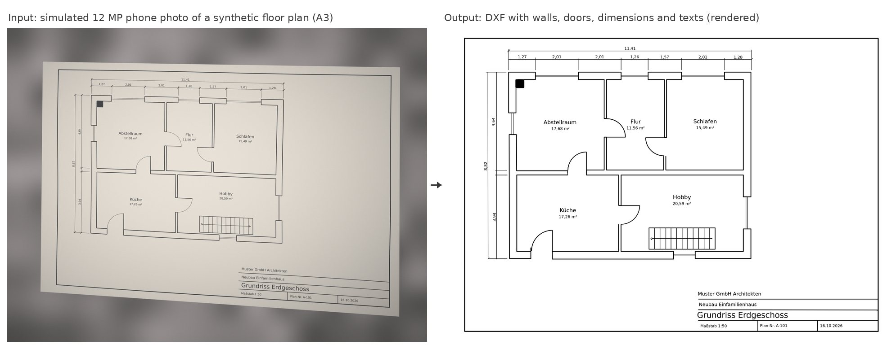
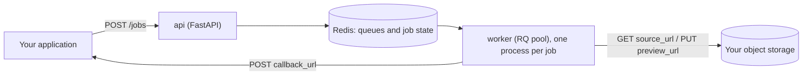

# cad-ingest

**Self-hosted, open-source CAD conversion service. It turns DWG, DXF, STEP, IGES, IFC, STL and other CAD files into
searchable Markdown and PDF or glTF previews, and turns photos and scans of engineering drawings (floor plans, P&IDs)
into editable DXF.**

[](https://github.com/weyer-data-engineering/cad-ingest/actions/workflows/ci.yml)
[](LICENSE)
[](https://github.com/weyer-data-engineering/cad-ingest/pkgs/container/cad-ingest)
[](#written-with-claude-code)

cad-ingest makes engineering files readable for search engines, RAG pipelines and large language models (LLMs), and
gives them previews that any browser can show. It runs as one Docker image on your own servers, with no cloud
service, no AutoCAD licence and no GPU.

- **CAD to text.** Title blocks, texts, dimensions, layers and blocks from DWG, DXF and HPGL. Assembly trees, part
  sizes and volumes from STEP, IGES and BREP. Storeys, building elements, materials and property sets from IFC
  (BIM). Sizes of STL, OBJ, 3MF and glTF meshes. Everything comes out as Markdown, ready for a search index or a
  vector store.
- **CAD previews.** DWG and DXF to PDF. STEP, IGES, IFC and meshes to binary glTF (GLB) for web viewers such as
  three.js or `<model-viewer>`.
- **Photo or scan to CAD.** A phone photo or a scan of a paper drawing becomes a DXF in real-world millimetres. It
  contains lines, arcs, circles, dashed lines, walls, doors, pipes, OCR text and the scale from the title block. P&ID
  symbols such as valves, pumps and instruments and floor plan fixtures such as toilets, washbasins and bathtubs
  become CAD blocks, from the starter libraries or from your own company library.
- **Ready for production.** An HTTP job API on Redis and RQ with queues, priorities, retries, callbacks and
  cancellation. Every file is converted in its own process with a time and memory limit. Release images for amd64
  and arm64 come with an SBOM and build provenance.


*Synthetic test drawing from the [benchmark](#benchmark), not a real document: a simulated 12 MP phone photo of an A3
P&ID (left) and the DXF that cad-ingest made from it (right). On this sheet it found 99.9 % of the linework within
1 mm, placed 95 % of the symbols as the right library block and read 82 % of the texts exactly, in 12 seconds. Text
it cannot read reliably goes to a separate layer for review.*

## Quick start

### Convert a single file

The `cad-ingest` command in the image converts one file. It needs no Redis and no setup:

```bash
docker run --rm --user "$(id -u)" -v "$PWD:/data" -w /data ghcr.io/weyer-data-engineering/cad-ingest \
  cad-ingest drawing.dwg out/
# out/drawing.md   searchable text
# out/drawing.pdf  preview

docker run --rm --user "$(id -u)" -v "$PWD:/data" -w /data ghcr.io/weyer-data-engineering/cad-ingest \
  cad-ingest plan.heic out/ --paper A3
# out/plan.md      texts and symbols found on the photo
# out/plan.pdf     the recognised drawing
# out/plan.zip     plan.dxf, plan.pdf, overlay.png for review, report.json
```

Options for photos and scans: `--paper A0..A4` (default `A3`), `--scale 50` for 1:50 (otherwise read from the title
block), `--drawing building|pid` and `--dpi` for scans without visible paper edges. For CAD files, `--no-preview`
only extracts the text.

### Run the service

```bash
git clone https://github.com/weyer-data-engineering/cad-ingest.git && cd cad-ingest
docker compose pull && docker compose up -d     # Redis, the job API on http://localhost:8080 and a worker
curl http://localhost:8080/health
```

### Submit a job

The worker downloads the file from a URL and uploads the preview to a URL, so it works with any object storage that
supports presigned URLs (Amazon S3, MinIO, Azure Blob Storage, Google Cloud Storage):

```bash
curl -X POST http://localhost:8080/jobs -H 'Content-Type: application/json' -d '{
  "external_id": "part-1",
  "file_name": "part.step",
  "source_url": "https://storage.example.com/part.step?X-Amz-Signature=...",
  "operations": ["extract", "preview"],
  "preview_url": "https://storage.example.com/part.glb?X-Amz-Signature=...",
  "callback_url": "https://app.example.com/cad-callback"
}'
# 202 {"id": "...", "status": "queued"}

curl http://localhost:8080/jobs/<id>
# {"status": "succeeded", "markdown": "...", "preview_content_type": "model/gltf-binary", ...}
```

When the job ends, the same JSON is posted to `callback_url`. The [job API](docs/api.md) describes every field, status
and error code. Interactive OpenAPI documentation is served at `/docs`.

## What you get

| Input | Extensions | Markdown | Preview |
|---|---|---|---|
| 2D drawings | `dxf` `dwg` `plt` `hpgl` `hpg` `hp2` | title block attributes, texts, dimensions, layers and blocks per layout | PDF, one page per layout |
| B-rep models | `step` `stp` `iges` `igs` `brep` `brp` | header data, assembly tree with instance counts, size, volume and surface area per part | GLB, +Y up, metres |
| BIM | `ifc` | project hierarchy, element counts, named elements, materials, `Pset_*Common` values | GLB, one node per building element |
| Meshes | `stl` `obj` `ply` `off` `3mf` `dae` `gltf` `glb` | objects, sizes, watertightness | GLB |
| Photos and scans of drawings | `jpg` `jpeg` `png` `tif` `tiff` `heic` `heif` `webp` `bmp` `pdf` (every page of a PDF or TIFF; CAD exports in PDF are read as vectors) | recognised texts and symbols with their tags | PDF of the recognised drawing, plus a ZIP with a DXF per page |

DWG files are read with LibreDWG, B-rep models with OpenCascade, IFC with IfcOpenShell, drawings with ezdxf and
meshes with trimesh. Native formats of SolidWorks, Inventor, CATIA, Revit and similar programs are not supported;
export them to STEP, IFC or DXF first.

The Markdown that `cad-ingest mounting-plate.dxf out/` writes for a small test drawing:

```markdown
# CAD drawing: mounting-plate.dxf

- Format: DXF, version AC1032 (R2018)
- Drawing units: mm
- Layouts: Model, Layout1

## Layout: Model

### Title block and block attributes

- Block TITLEBLOCK:
  - TITLE: Mounting plate; DRAWING_NO: MP-1042; MATERIAL: S235JR; SCALE: 1:1

### Texts

- 2x bore D16 H7
- All edges chamfered 0.5x45

### Dimensions

- linear 120
- linear 45

### Blocks

- TITLEBLOCK

Layers: CONTOUR, DIMENSIONS, TEXT, TITLE
```

## Use cases

- **RAG and enterprise search over engineering data.** Index DWG, STEP and IFC files next to PDFs and Office
  documents, so that an assistant can answer "Which drawings use S235JR?" or "Where is pump P-101?". It fits next to
  document parsers such as Docling, Apache Tika or Unstructured, which have little or no support for CAD formats.
- **Previews in your own software.** Show CAD files in a document management system, a PLM or PDM tool, an intranet
  or a chat application without a CAD viewer plugin.
- **Digitising paper drawings.** Turn old floor plans, P&IDs and flow sheets that only exist on paper, as scans or as
  phone photos, into DXF. You can then finish them in AutoCAD, BricsCAD, DraftSight, LibreCAD, QCAD or FreeCAD instead
  of redrawing them from scratch.
- **Batch conversion.** Feed whole archives through the `bulk` queue while interactive uploads keep priority.

## Photos and scans to DXF



*Synthetic test drawing, simulated phone photo: walls, door swings, dimensions, room names and the scale 1:50 from
the title block.*

The pipeline in `app/plan2cad` finds the sheet in the photo and removes the perspective. It evens out shadows and
glare and traces the linework into lines, arcs, circles, dashed lines and filled areas. Pieces that belong together
are joined into walls, pipes and equipment outlines. Texts are read with Tesseract OCR, and the scale is taken from
the title block. Symbols are matched against DXF symbol libraries and placed as their blocks: valves, pumps and
instruments on P&IDs, with their tags as attributes, and toilets, washbasins, bathtubs and other fixtures on floor
plans. Two starter libraries are built in: 18 P&ID symbols after DIN EN ISO 10628-2 and seven floor plan fixtures.

Your own symbols plug in as a library: a folder with your CAD blocks and a short `library.toml`. The DXF then holds
your original blocks, with your layers and attribute names. Install libraries on the server, or let each job bring
its own (one per tenant, say). `cad-ingest library build` collects existing DWG or DXF blocks into a library, and
`cad-ingest library check` tests it on simulated scans and photos. [Symbol libraries](docs/symbol-libraries.md)
explains the format.

A PDF exported from CAD needs no recognition: its pages are read as vectors, so the DXF has the exact lines, arcs,
texts, colours and pen widths, on the CAD layers of the PDF.

The result is a ZIP with:

- `plan.dxf`: real-world millimetres, one layer per kind of object, the straightened photo as an underlay;
- `plan.pdf`: the drawing as vectors on its paper size;
- `overlay.png`: the recognised vectors in colour on the faded photo, for checking;
- `report.json`: sheet, resolution, drawing type, scale, counts, all texts, the symbols with their library and ports.

There is no DWG output. Every CAD program opens DXF, and the free ways to write DWG are either not licensed for
commercial use or experimental. [Photos and scans](docs/photos-and-scans.md) explains each step, the symbol library
and the limits.

### Benchmark

`bench/` generates drawings with an exact reference solution. It simulates scans and phone photos with perspective,
waviness, folds, shadow, glare, blur, noise, phone sharpening and JPEG artefacts, and then measures the DXF against
the reference. A selection of the results (mean over 1 to 3 seeds per case):

| Case | Linework found / correct (within 1 mm) | Texts exact | Symbols found / correct | Runtime |
|---|---|---|---|---|
| Floor plan A3, scan 300 dpi | 100 % / 100 % | 100 % | - | 8 s |
| Floor plan A3, phone photo 12 MP | 99.9 % / 100 % | 100 % | - | 5 s |
| Floor plan A3 1:50 with fixtures, phone photo 12 MP | 99.9 % / 100 % | 100 % | 100 % / 100 % | 7 s |
| Floor plan A3 1:100 with fixtures, phone photo 12 MP | 99.7 % / 99.9 % | 90 % | 93 % / 90 % | 8 s |
| P&ID A1, scan 200 dpi | 99.9 % / 99.4 % | 87 % | 94 % / 93 % | 31 s |
| P&ID A1, phone photo 12 MP | 99.2 % / 96.7 % | 18 % | 78 % / 77 % | 32 s |
| P&ID A0, scan 200 dpi | 100 % / 98.9 % | 84 % | 91 % / 91 % | 53 s |
| P&ID A0, phone photo 48 MP | 99.1 % / 98.3 % | 34 % | 82 % / 85 % | 45 s |

Linework holds up down to about 3 pixels per millimetre of paper, but text needs about 8. Scan large sheets at 200 to
300 dpi rather than photographing them. The [full table](docs/photos-and-scans.md#benchmark) also has the harder
cases. Run it yourself with `python bench/run.py --out bench/out --quick`.

## How it was validated

- **Real drawings.** During development the photo and scan pipeline was checked again and again on a real
  engineering document: a phone photo (HEIC) of a printed P&ID, on which cad-ingest places 57 symbols in about a
  minute. Real documents belong to their owners and are not part of the repository, so the published numbers come
  from synthetic drawings that anyone can regenerate.
- **Ground truth.** The benchmark scores every result against an exact reference, so improvements are measured
  rather than judged by eye. Every change to the pipeline is benchmarked before and after.
- **Tests in the image.** More than 140 tests run inside the container image, with the same native libraries as in
  production. They cover every CAD format and the photo pipeline. The job tests use a real Redis and real worker
  processes. They include broken files, conversions killed by the kernel, cancellation, retries, callbacks, a full
  queue, a Redis outage and jobs left behind by a dying worker.
- **Two architectures.** CI runs the full suite natively on amd64 and arm64. Benchmark results on arm64 are within
  about one percentage point of amd64.
- **Hardened container.** All formats convert as a non-root user, with every capability dropped and a read-only root
  filesystem.

## Architecture



One image holds three components. The stateless `api` can run with any number of replicas. The `worker` runs one
RQ worker per parallel conversion, and each job gets a fresh work-horse process with a hard timeout and an
address-space limit. Redis holds the queues and the results. With a persistent Redis, jobs survive restarts of any
component: interrupted jobs run again, callbacks are retried, and results stay readable for a day.
[Operations](docs/operations.md) covers configuration, scaling, memory sizing and failure handling.

## Origin

cad-ingest was built as the CAD conversion service of AITEZA, an AI knowledge platform. There it makes CAD files
searchable for retrieval-augmented chat, shows their previews and turns photographed plans into drawings. It runs as
a separate service, has no dependency on AITEZA and is published here so that others with the same problem do not
have to start from scratch.

## Written with Claude Code

All code, tests, the benchmark with its synthetic drawings, the CI pipeline and this documentation were written by
[Claude Code](https://claude.com/claude-code), Anthropic's coding agent. An engineer at weyer data engineering set the
goals, supplied real drawings for testing and reviewed the results. [CLAUDE.md](CLAUDE.md) holds the guidance that
coding agents follow in this repository. Contributions are welcome, whether they are written by hand or with an AI
assistant.

## Limits

- Small text on photos and scans needs about 8 pixels per millimetre of paper. A single 12 MP photo of an A0 sheet has
  2.8, so use a 200 to 300 dpi scan for A0 and A1. Unread text is kept as a guess on its own layer for review.
- Only symbols in the selected libraries are recognised. Everything else stays linework. Fixtures on floor plans are
  found at 1:50 and 1:100, or at the scale a job names; at 1:100 about one in ten is placed wrongly.
- Paper that is not flat (waves, folds) shifts lines by up to a millimetre.
- DWG is read through LibreDWG, which does not support every object of every AutoCAD version. Files that it cannot
  read fail with `unreadable` rather than producing a wrong preview.
- Do not expose the job API to untrusted clients: whoever submits jobs decides which URLs the worker requests. See
  [SECURITY.md](SECURITY.md).

## FAQ

**Can I convert DWG to PDF without AutoCAD?** Yes. `cad-ingest drawing.dwg out/` writes a PDF with one page per
layout, and `extract` gives you the texts and title block as Markdown.

**Can I get text out of STEP or IFC files for an LLM?** Yes, that is what `extract` is for. It gives you the
assembly tree, part names, sizes and volumes from STEP, and the building structure, elements, materials and property
sets from IFC, as Markdown that you can chunk and embed.

**How do I turn a scanned or photographed drawing into CAD?** Use `cad-ingest plan.jpg out/ --paper A1`, or the
`vectorize` operation of the job API. You get a DXF that AutoCAD, BricsCAD, LibreCAD, QCAD and FreeCAD open
directly.

**Does it need a GPU, an internet connection or a cloud account?** No. Everything runs on the CPU inside the
container. Apart from Redis, it only connects to the URLs that you put into a job.

**Can it recognise our own P&ID symbols or furniture blocks?** Yes. Put your CAD blocks into a symbol library, add
the points where pipes connect, and check it with `cad-ingest library check`. Fixture and furniture blocks drawn at
real size work as they are: say `size = "real"` and `drawing = ["building"]` in `library.toml`. See [Symbol
libraries](docs/symbol-libraries.md).

**Which OCR languages are included?** German and English. The default is `deu`. Set `OCR_LANGUAGES=eng` or
`deu+eng` for your drawings.

**How much memory does it need?** In our measurements, phone photos needed up to 2 GB per conversion, an A0 scan at
200 dpi about 3 GB and at 300 dpi about 4 GB. Typical CAD files need less. Give the worker container a memory limit;
[Operations](docs/operations.md#scaling) explains the sizing.

## Documentation

- [Job API](docs/api.md): endpoints, fields, errors and callbacks
- [Operations](docs/operations.md): processes, configuration, restarts, scaling and isolation
- [Photos and scans](docs/photos-and-scans.md): the vectorisation pipeline, benchmark and limits
- [Symbol libraries](docs/symbol-libraries.md): your own P&ID symbols, the library format, `library check` and `build`
- [Changelog](CHANGELOG.md)

## Contributing

Bug reports with a sample file, new P&ID symbols, format support and documentation fixes are all welcome. Read
[CONTRIBUTING.md](CONTRIBUTING.md) first. `docker build --target test .` runs the complete test suite in the image.
Report security problems privately as described in [SECURITY.md](SECURITY.md). Everyone taking part follows the
[Code of Conduct](CODE_OF_CONDUCT.md).

## Licence

cad-ingest is licensed under the [Apache License 2.0](LICENSE). Copyright 2026 weyer data engineering gmbh; see
[NOTICE](NOTICE).

The container image bundles third-party software under its own licences:

| Component | Licence | Use |
|---|---|---|
| LibreDWG (`dwg2dxf`) | GPLv3 | separate command-line process, not linked; built from the pinned release tarball in the `Dockerfile` |
| OpenCascade (OCP) | LGPL 2.1 with exception | Python extension |
| IfcOpenShell | LGPL 3 | Python extension |
| pi-heif (libheif, libde265) | BSD 3-clause (LGPL 3 shared libraries) | HEIC decoding only, without the GPL x265 encoder |
| Tesseract, pytesseract | Apache 2.0 | separate command-line process |
| OpenCV, pypdfium2 (PDFium) | Apache 2.0 / BSD 3-clause | Python extensions |
| scikit-image, SciPy, RQ | BSD 3-clause / BSD 2-clause | libraries |
| matplotlib | PSF-compatible (BSD-style) | PDF rendering |
| ezdxf, trimesh, redis-py, httpx, FastAPI, uvicorn, numpy, lxml, networkx, pycollada | MIT / BSD | libraries |

There are no AGPL dependencies.

---

Keywords: open-source CAD converter, self-hosted CAD conversion API, DWG to PDF, DXF to PDF, DWG to text, CAD to
Markdown, STEP to glTF, STEP to GLB, IFC to glTF, IFC property sets, STL to GLB, CAD file preview, CAD metadata
extraction, title block extraction, CAD search, RAG for engineering documents, LLM document ingestion, image to DXF,
photo to CAD, scan to CAD, raster to vector, drawing vectorization, P&ID digitization, P&ID symbol recognition,
custom CAD block library,
floor plan digitization, engineering drawing OCR, Docker, FastAPI, Redis, RQ.
