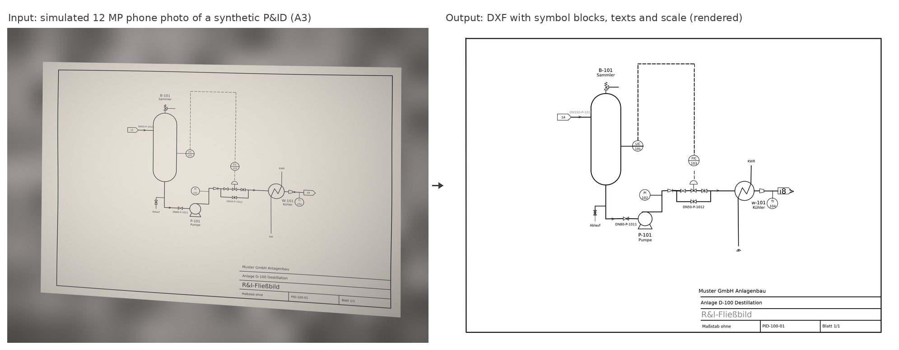
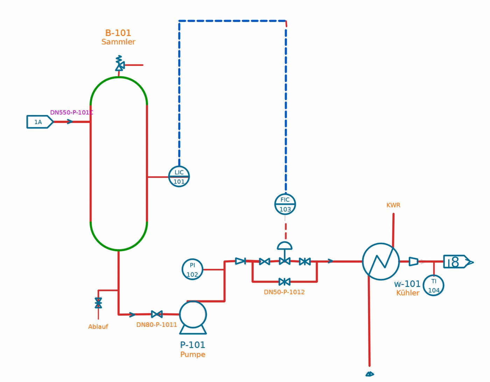

# Photos and scans to DXF (`vectorize`)

Engineering teams often receive plans only as phone photos or scans. The job operation `vectorize` (and the
`cad-ingest` command for photos and scans) turns them into an editable CAD drawing. The code is in `app/plan2cad`, the
job handler in `app/scan.py`.



*Synthetic test drawing from the benchmark, not a real document.*

## How it works

1. **Sheet**: finds the paper in the photo (GrabCut, edges refined at full resolution) and removes the perspective. If
   the paper runs out of the picture, it uses the printed drawing frame instead (aspect ratio from the perspective,
   Zhang & He). Scans without visible paper edges are deskewed. On a scanner lid about as grey as the paper, which
   colour does not tell apart, the paper is found by the long straight step of grey along each side of the image: the
   median grey on either side of a step, so a printed line such as the frame is no step, with the lid even out to the
   side of the image. A side without such a step is the image's own edge, and the image must be paper out to it, not
   lid: a small sheet near the corner of a large scanner bed shows lid there. The edges must make a rectangle of the
   paper's aspect ratio within 1 % and agree with the scan's `dpi` within 1 % where that is known. Where they fill
   most of the image with a side of its own, the image itself must fit that aspect ratio worse, as a copy cropped to
   its sheet with a dark band along an edge does not. Otherwise the scan is taken as it is, as before (step
   `paper_edge`).
2. **Light**: on a colour plot, takes the darkest colour channel as grey value where the colour is strong (so yellow
   and orange lines are ink as dark as black ones; colour casts of photos are too weak for this). On a black and white
   print, strong colour is a markup added by hand and is taken out of the drawing, see [Markups](#markups). Then it
   divides by the paper brightness (a closing that follows soft shadow edges) and binarises against the darkest ink
   nearby, so glare and light toner keep their lines. Fainter stretches of a stroke are added where they hang together
   with clear ink, so a pale or dotted line stays one line.
3. **Print size**: a large drawing is often printed small to take along, an A1 P&ID on A3 or A4. Its lettering is then
   much smaller than drawings are lettered (about 2.5 mm), and so are its symbols, pens and gaps. The most common
   height of the shapes of ink the size of a character tells the share it is printed at (half for A1 on A3); it is
   measured on the ink, not on what is read, as the text of a small print may be too small to read. Only heights at
   which most shapes stand in a row with another of their height count, as the characters of words and numbers do:
   specks of dirt on a poor scan stand alone, and a poor scan full of them was taken for a print at a fifth of its
   size (step `letter_rows`). Such a sheet is recognised at the drawing's drawn size, because the measures of
   recognition, such as how far a line may lie off a symbol's outline or how short a pipe may stop of a junction, are
   made for drawings at their drawn size: on a small print a plain line fitted a flow arrow, and pipes were not joined
   to their valves. Where the image has fewer than 5 pixels per drawn millimetre, as a phone photo of a small print,
   lines and texts are found on the sheet as it is (at the drawn size they would fall apart into short pieces), and
   only objects and symbols are recognised and the linework connected at the drawn size. `report.json` gives the
   share as `printed` (1 for a drawing printed at its size), and the DXF is at the drawn size.
4. **Vectors**: filled areas (thicker than 1.5 mm; a round one with a round opening, such as the thick ring of a note
   mark, is a circle with a wide pen, and the letter in its opening is read), horizontal and vertical lines
   (morphology), circles (Hough, verified
   on all ink; text found on a ring is dropped as misread symbol arcs, and a ring whose quarters OCR took for brackets,
   such as a circle in a box, is found as well), everything else by skeleton tracing. A traced stroke that is round
   becomes one arc (of up to 1.5 m radius on paper, a street on a site plan); one that runs straight and then bends is
   cut into the fewest straight lines and true arcs that
   follow it, so a rounded corner, a vessel head or the round end of a line-number box is one arc or a few tangent
   ones, not a chain of short lines. Arcs that lie on one circle and were cut apart by a line become one arc again.
   Collinear pieces are joined: a piece joins the line it continues at that line's own offset, so short strokes
   between two parallel lines, such as letters touching a pipe and the box of its line number, do not pull them onto
   one line. Pieces that run within a degree of one another are measured at one angle, that of the longest of them:
   measured each at its own, pieces far from the corner of the sheet were joined millimetres off, and the lines of a
   dense hatching moved across the line they end on. Each joined line is drawn at the angle of its own pieces, so a
   long line keeps its angle beside a short piece of the same direction (step `merge_where_drawn`). Regular pieces
   become dashed lines, corners are closed. A dashed
   line is then measured along its length on the grey image: its dashes, dots and gaps tell a dashed line (dashes
   only), a dash-dot line (a dot between each two dashes, such as an axis) and a dotted one (dots only, such as the
   ground as it was), and how long one repeat of its pattern is (step `linetypes`). Long dashes in line, too far apart
   to be joined as dashes, become one dash-dot line where the grey image shows a dot in their gaps (a line crossing the
   gap is no dot), and a row of six or more small dots at one spacing one dotted line (dots too small to trace would
   be lost). Not taken for dotted lines are fields and grids of dots, such as a hatch or a screened area, and rows of
   specks of uneven size or darkness or with ink between them on the grey image, such as a solid line whose ink broke
   up. Two or three dashes that run from one stroke to another, such as a short signal line between an instrument
   bubble and the symbol it acts on, become one dashed line; a short dash on its own is kept, not dropped as a speck. A
   gap of up to 5 mm in a line is closed where the grey image shows a stroke along it (a faint stretch darker than the
   paper beside it, a
   crossing that cut it), and a branch that stops short of the pipe it points at is extended onto it; gaps of bare
   paper, such as dashes and line jumps, and the inside of a small symbol stay open. The round ends of a line-number
   box and rounded corners between two lines are kept from text recognition, which would read them as brackets; only
   the part beyond the two line ends, so a letter touching a round end from inside the box is still read.
5. **Objects**: pieces that meet end to end become one polyline (a wall outline, a pipe run through its bends, a vessel
   with its heads); slivers and loose specks from the tracing are dropped. Floor plans get door swings (leaf and quarter
   arc) and walls, P&IDs equipment (large closed outlines), signal lines (dashed or ending at an instrument bubble) and
   pipes.
6. **Text**: characters of similar height are grouped into lines first, and small marks such as dots, hyphens and
   quotes join the line they sit in, so two text lines beside a slanted stroke stay apart. The lines are read by
   Tesseract in batches with its most accurate models (`tessdata_best`). A drawing is written in one font, so a
   character read unlike the glyphs that look most like it on the same sheet is corrected by their vote: the slashed
   zero of a plotter font reads as 8, 9 or B now and then, but as 0 mostly. Only a clear majority, 12 of the 16 glyphs
   most like it, changes a character: a class of glyphs read half one way and half the other would go one way or the
   other as a whole, turned by a few glyphs more or less elsewhere on the sheet. A vote without a clear majority keeps
   the reading and marks the text for review, unless the token decides it: once the kind of drawing is known, a token
   that is a word of its [profile](profiles.md)'s vocabulary in only one of its readings, as read or as voted, takes
   that one ("DN80-P-1011", not "0N80-P-1011"; step `lookalike_tokens`). In a code, an O or I next to a digit is a
   0 or 1 (`PN16`, `C=01XY2Z`). The sheet is turned if its text
   reads better turned: each rotation counts horizontal text the right way up together with vertical text reading
   bottom to top, so a P&ID full of vertical pipe labels is not taken for a sideways sheet. Text at another angle,
   such as a street name, a parcel number or a height along a contour on a site plan, is read along its line (step
   `oblique_text`). A line grouped along an axis is oblique where it runs further off the axis than its letters can
   tell: 3 degrees for a long line, more for a short one (about 8 degrees for three letters, 4.5 for ten), as the
   letters of a short word on a phone photo lean with the paper and a descender tilts the box around them. Both the
   box around its letters and the line through their centres must run so far off, and so must each half of a line of
   six letters or more: a level label that the first letters of a street name beside it joined bends at its end.
   Nearer the diagonals, where the axes group a line in pieces, its characters are grouped anew along the diagonal.
   At least three characters must be centred on a straight line. The line is cut out turned to the horizontal and read
   both ways round, and the surer reading stays, with the angle of the line; within 30 degrees of the horizontal, the
   reading upside down replaces a sure one the usual way round only through the vocabulary (below), as "501" leaning a
   little reads upside down as "10%" now and then. One that cannot be read surely stays linework, as the pieces of a
   broken hatching line up like letters. The text spotter reads such a line along its turned box, both ways round,
   too, where the box is clearly longer than high; the line keeps that angle only where its letters run off the axes
   by more than they can tell, or, where fewer than three letters are found, its box does. Where they do not, the box
   leaned for another reason (a descender, a level mark beside the text, the paper of a photo), and the line keeps the
   reading the spotter found it with, unless the reading along the box is clearly surer: the same pixels read again
   read worse now and then ("±0,00" as "±0,08", "Kühler" as "Kuhler"). Vertical lines are read
   top to bottom as well as bottom to top (step `text_direction`), the reading top to bottom only for three glyphs or
   more and with a character for each: the two barbs of a flow arrow on a horizontal pipe, one above the other, read
   so as letters.
   Where both readings are plausible, the one whose tokens are words of the vocabulary of the kind of drawing is taken
   once the kind is known: "0,60", not the same text upside down, "09'0". Where that does not tell, the surer reading
   stays, the usual way round where both are about as sure. A vertical line the spotter was unsure of, which read
   again both ways round only reads the same more surely, stays marked to check unless each of its words is one of
   the vocabulary: a blurred comma reads as a point either way round ("3.94" for "3,94" on a building drawing). A
   short vertical line, such as a two-digit wire number,
   has a box about as wide as high, like a short horizontal one: where its characters stand one above the other, it is
   read as vertical, both ways round, unless it reads clearly better as it stands or the vertical reading has fewer
   characters than shapes stand there (the two barbs of a flow arrow on a horizontal pipe stand so too, and read as
   one letter). Pieces of one vertical line that the spotter found in overlapping boxes are read as one line, where
   each box about as wide as high reads about as surely turned to vertical, with as many characters: a horizontal tag
   at the end of a vertical label is no piece of it ("M1" turned reads "M"). Where the line reads less surely whole
   than its pieces did, the pieces stay. Without
   the direction classifier of the spotter, which now and then turns a short horizontal line upside down ("L+" read as
   "+7"), the horizontal lines of the upright sheet are read as they stand. A single character is read where it stands
   alone in a frame, such as the loop letter of an instrument bubble or an interlock diamond; elsewhere a lone stroke
   of that size is as likely part of a symbol. It can be read as the letter or the digit it may be where the
   [profile](profiles.md) of the kind says that its frames hold only letters or only digits (step `framed_letters`).
   The text in circles that hold text is read a
   second time without the ring and the line across a shared display, so letters that touch them are not lost. A box
   or ring around letters, such as the box of a line size, is no character: read with them, it garbled them. A bar
   read at either end of a line ("| LT"), the end of a leader beside the text, stays linework. Bars across a pipe are
   no letters (step `text_on_pipes`): where a pipe runs along the middle of a line the spotter found, from beyond one
   of its ends a good way into it, that end is the bars of a flange on it ("HH" read before a standing line label),
   with what lies between it and the next such stretch of the pipe (a valve between two flanges); the rest is read
   again. A line with no rest is dropped, with the letters Tesseract read in its box: the crosses on a capillary line
   read as "xxxx" (or "IN") are linework. A single character with a pipe through it or along its strokes, which
   runs on past it on both sides with ink on both sides of the pipe, is the two bars of a flange ("H"); a digit above
   a dimension line has no ink below it. A text a pipe runs into at both ends may be a valve read as letters ("Hoeat"
   for one standing between two flanges): it does not count as a word when the symbols are matched, so a symbol that
   explains its strokes takes them and the text goes. A line label in a frame stands apart from the pipe by its
   frame. The scale is read from the title block. The drawing type weighs room areas (m²) and a building scale against
   nominal sizes (DN), instrument bubbles and a title such as "R&I". Text that cannot be read reliably stays a text (a
   guess on its own layer to check) instead of turning into a heap of short strokes, also where the scan merged
   touching letters, as long as as many characters were read as the line's length holds (a valve read as two large
   letters stays linework).
   Then a learned text spotter reads the sheet once more: PP-OCRv6 small, a text detector and recogniser (Apache-2.0
   models run by RapidOCR on ONNX Runtime, on the CPU), finds the text lines in overlapping tiles of 1600 px (a sheet
   coarser than 10 px/mm is enlarged first, or small text is missed) and reads them. It finds letters that touch a
   line or the ring of a bubble, and reads plotter fonts, the slashed zero and touching letters much better than
   Tesseract. A spotted line replaces the texts whose letters lie in its box, unless it is a shorter reading across
   part of a text written the other way (a vertical dimension read as two numbers). Its letters are the components
   wholly in the box and about as high as most of them, so a pipe or a ring that touches the line, or a dash, stays
   linework. A line through which a stroke runs from above its letters to below them, between two of them, is two
   texts where the two are a letter's height apart or read with a space between them: the spotter reads a line
   number and the tag in the bubble next to it as one line, across the end of the frame and the ring of the bubble,
   and two labels across the line between them; a wall through a room's area, close between two digits, cuts nothing.
   Where no text was found before, a reading needs a score of 0.8, and one of one or two characters 0.9 and no more
   than 1.6 times the usual text height: such a reading is as likely a symbol (a valve read as two letters, a fixture
   as "8"). A replacement scored below 0.8 is marked for review, and the characters both readers confuse go to the vote
   of their look-alikes on the sheet, Tesseract's readings among them, since the two readers make different
   mistakes. A character both read alike, the spotter at a score of 0.8 at least and Tesseract in a text not marked,
   is not voted over (step `lookalike_tokens`): two readers that see a glyph in different ways agree on it. A line
   longer than the overlap of the tiles comes in pieces cut by a tile edge; the pieces of one line
   are read again as one. Where the characters map one to one to the glyphs, a space the recogniser dropped is put
   back at a gap 2.5 times as wide as the line's usual one ("11,56m²").
   Last, marks the readers confuse are put right where the sheet itself shows how it writes them. On a sheet with at
   least three pipe sizes in inches before their specification or in a reducer (`2" -AB12`, `4"x3"`), the mark after
   such a size, or after a nominal pipe size on its own, is an inch mark, whatever was read for it (`2°-AB12`, `2'`);
   angles (`45°`), temperatures (`60°C`) and feet and inches (`12'-6"`) keep theirs. On a sheet with at least two
   key=value labels (`PN=16`), a colon between a short key and its value (`PN:16`) is the equals sign.
   Hatching is no text, though it reads as "IIII" or "////": once the outline of a narrow hatched area, such as a cut
   slab of a section, is taken out as lines, its short strokes stand in a row like characters. A text line of at
   least five parallel straight strokes, leaning at least 25° from upright (more than italics) and 20° from along the
   line (less than dashes), goes back to the linework and is traced with the outline it ends on (step `hatching`).
7. **Symbols**: valves, pumps and instruments on P&IDs (and on drawings of unknown kind), toilets, washbasins, bathtubs
   and other fixtures on floor plans are looked up in symbol libraries and placed as their CAD blocks instead of loose
   strokes, see below.
   Then the linework is connected, so that it can be worked on in CAD without closing gaps by hand: tracing stops a
   line short of a junction by about the width of the line it meets, and taking out the strokes of a symbol leaves its
   pipes a little short of it. An end of a line or polyline that stops up to 2 mm short of other linework is moved
   along its line onto it (a branch onto its pipe, a signal line onto its bubble, a pipe onto its valve or vessel), or
   cut back onto a line it runs past by a little; two loose ends whose lines meet nearby form a corner there, and two
   that point at each other along one line meet halfway. A line drawn broken where it crosses another, to show that
   the two do not join, becomes one line across it, without a junction: two ends further than 2 mm from a single line
   between them, which point at each other along one line no more than 8 mm apart. A port of a symbol that no line
   reaches, but that faces a pipe or the port of the next symbol within 6 mm, is piped to it: the short pipe between a
   valve and its junction, with its flanges, is often lost with the strokes of the symbols around it. Pieces that then
   meet end to end become one polyline, through a crossing the ones that go straight on, and pieces under 2 mm that
   touch nothing are dropped as leftovers. With the step `short_strokes` (off by default), a short stroke across a line
   is taken as drawn on purpose and stays: the tick on a dimension line, a flange mark across its pipe; pieces under
   1 mm stay noise. Where taking out the line cut such a stroke in two, its two pieces are one stroke again if the line
   through their outer ends stays within half the stroke's width of both; the pieces of a curve bend away from it and
   stay apart. It is off as on the benchmark it kept far more of the short strokes of floor plans and sections, but
   cost a few junctions, curves drawn as arcs and lines within 0.5 mm there (see [Steps that can be
   switched](#steps-that-can-be-switched)). A text read twice at one place is kept once (step `dedupe`), and the texts
   are lettered as with a stencil (see [Output](#output)). Then a polyline of plain linework that turns smoothly, with
   no corner sharper than 20 degrees between its pieces, is drawn as the curve it is: one arc where it turns by 8
   degrees or more in all and all of it lies on one circle (within 0.15 mm, or within the stroke of a wide pen). Where
   an end of it is joined to other linework, the arc passes through that end if a circle through it fits as well, so
   that it stays joined. Otherwise, where it is made of short straight pieces (none over 10 mm) that turn one way
   along each bend and bend away from the straight line through its ends by more than 0.3 mm, it becomes a spline
   that stays within 0.3 mm of it (a contour line; step `splines`). True arcs and long straight pieces, such as a
   straight road running into a bend, stay as they are, and so does a straight line traced with a small jog, such as
   where another line crosses it: it turns to and fro, hardly at all in all. Then lines drawn parallel or at right
   angles are made exactly so (step `square_lines`): a traced line leans by the noise of its ends, a long wall by a
   few hundredths of a degree, a short pipe between a valve and a junction by a few tenths. The directions of the
   sheet are the axes and each direction that at least three straight segments of 30 mm in all share (mod 90
   degrees, so with its right angle), such as the sides of a building turned on a site plan or a hatching; the chords
   of a curve, which bend into each other by more than their noise allows and less than 25 degrees, back none, and a
   single oblique line, such as a roof pitch, a stair line or a leader, makes none and stays as drawn. A straight
   segment of a line, a polyline or a dimension whose direction lies within what the noise of its ends allows of such
   a direction (atan(0.6 mm / length), from 0.5 degrees for a long segment to 5 for a short one) is turned to exactly
   it; one along an axis gets two equal coordinates. Pieces of one direction whose offsets differ by less than 0.15 mm
   are put on one line. Where segments meet (a corner, a T, a line ending on another, on a ring, an arc or a filled
   area, or at the port of a symbol), the meeting point is placed where the turned lines meet, so corners stay closed
   and Ts stay on their line. A symbol whose ports the turned pipes no longer reach is moved onto them, without
   turning, by as much as they need; one that would have to turn stays where it is, and the pipes at its ports turn
   about them. No point of the linework moves more than 0.5 mm: where one would, the shortest segment that ends there
   stays as drawn. A dimension line turns like the others, and its ends move to where its extension lines meet it at
   right angles. Texts, arcs, circles and symbols are not turned. The step runs after the curves, whose chords it
   would bend, and before the title block, whose rulings it squares; no later step moves the linework (marks by hand
   are added after it, as drawn). Then the title block is read as a table
   (step `title_block`, see [Output](#output)): after the curves, as the flattest chords of a curve in it, such as a
   logo, would cut its cells, and the chords of a spline cut none. Then linework that looks like a symbol but was
   recognised as none of the libraries' is kept as it was traced, on a layer of its own (step `unclassified`, see
   [Symbols not classified](#symbols-not-classified)); what lies in the title block is the block's. Then the pen of
   every line, arc, circle, polyline and dimension is measured again on the grey image: the ink across the stroke
   divided by the darkness of the ink nearby, which blur does not change, instead of its width on the binary image,
   which blur and the threshold widen (step `width_calibration`). The ticks and open arrowheads of a dimension take the
   pen of its dimension line: a tick is too short to be measured off the crossing it stands on, and the dimension line
   runs between the sides of an open arrowhead. Last, with the step `pens` (off by default), the linework gets a few
   pens, as many as the drawing has.
8. **Markups**: pen strokes and highlighter in colour on a black and white print become their own layers, see
   [Markups](#markups).
9. **Dimensions**: a dimension line with its terminators, extension lines and value becomes a CAD dimension, see
   [Dimensions](#dimensions). This happens after the texts are read and before the linework is joined.

## Output

The ZIP holds `plan.dxf` (real-world millimetres, one layer per kind of object: `P2C-WALL`, `P2C-DOOR`, `P2C-PIPE`,
`P2C-EQUIPMENT`, `P2C-SIGNAL`, `P2C-FRAME`, `P2C-TITLEBLOCK`, `P2C-LINE`, `P2C-DASH`, `P2C-CURVE`, `P2C-FILL`,
`P2C-TEXT`, `P2C-TEXT-CHECK`, `P2C-SYMBOL`, `P2C-SYMBOL-CHECK`, `P2C-SYMBOL-UNCLASSIFIED`, `P2C-DIMENSION`,
`P2C-DIMENSION-CHECK`, and for markups `P2C-MARKUP`, `P2C-HIGHLIGHT` and `P2C-MARKUP-TEXT`; ISO line weights; the
linetypes `DASHED`, `DASHDOT` and `DOT`, each line scaled to the pattern measured on it; free curves as splines on
`P2C-CURVE`; the
straightened photo `underlay.png` as raster underlay on `P2C-UNDERLAY`),
`plan.pdf` (vector, on the paper size), `overlay.png` (the recognised vectors in colour on the faded photo, symbols in
teal and dimensions in olive, for checking), `markup-k.png` for each markup and `report.json` (sheet, resolution,
drawing type, the steps its profile switched off, scale, counts, timings, all texts, the title block as a table, the
symbols with their attributes and ports, the dimensions, the lines joining two symbol ports, the symbols not
classified, the markups and what to check).
`extract` lists the recognised texts, symbols (with their tags), dimensions and markups as markdown, so photographed
plans become searchable too.

The title block becomes a table. It is the grid of ruled cells in the corner of the drawing frame's right and bottom
line, where ISO 5457 puts it: the rows that run to the frame's right line from one left side, stacked up from its bottom
line. The frame's right and bottom line are the long lines near the sheet's edge that meet at its bottom right corner.
No layout is assumed. The rows and columns are those of all its rulings, and cells that no ruling divides are one
cell that spans several rows or columns. A single line across the whole frame is no title block. Where a block is open
at its top and texts stand in a row above its topmost ruling, it gets a top row as high as the middle one of its other
rows. Each cell holds the texts whose centre is in it, in reading order.
`report.json` has the table as `title_block` with its `box_mm`, `rows`, `cols` and `cells` (`row`, `col`, `row_span`,
`col_span`, `box_mm`, `text`, and `uncertain` where a text in it is to be checked), the markdown has a section `Title
block` with it, and the DXF has the block's lines, arcs and circles on `P2C-TITLEBLOCK` (step `title_block`).

Texts are lettered as with a stencil, since a drawing is lettered in a few sizes: a text whose height is within 20 %
of a height at least three texts share takes it, and the texts of one size get one width per character (narrow ones,
such as spaces, points and the digit 1, half of it), so the same label looks the same wherever it is. Every text of
the DXF, the tags in a symbol's bubble included, is fitted between the ends of its baseline at that width (DXF
alignment "fit"), so it looks the same in whatever font the CAD program shows it; a text printed clearly narrower
than that (by more than 15 %) keeps its printed length, so a tag stays inside its bubble and a line number inside
its frame. A text spaced wider than that keeps where it starts, so notes and legends stay flush left. The preview
squeezes a text along its line only, as CAD does. A text whose letters were found only in part (where they touch a
line) is lettered at the usual width of its size, as fitted to that part it would shrink to a fraction of its size.

`report.json` lists what to check under `review`, least confident first: texts that could not be read
reliably (on `P2C-TEXT-CHECK`) and symbols that may be the wrong ones (on `P2C-SYMBOL-CHECK`, and in magenta in
`overlay.png` like the texts to check). A symbol is one to check where less than 90 % of its outline was found, or where
a symbol of another kind fits its place almost as well (with at least 90 % of its score); a ball valve and a gate
valve do not count as such, as the ball decides between them. Each entry says what was recognised, why it is
doubtful, where it is on the sheet and how confident the recognition is, so a person can look at just these places
instead of the whole sheet. A job can also have a vision model look at them first (`reviewer` in the [job
API](api.md)): it sees only a crop around each, and its answer is taken only where it fits the reading or the
library's symbol.

Scans often arrive as PDFs or TIFFs with several pages. Every page is converted on its own (one at a time, so memory
stays that of one page): the first page with a drawing at the root of the ZIP, every further page n in `page-n/` with
the same files. Pages without a drawing, such as a cover letter, are skipped with a warning. `options.pages` (command
line `--pages 1-3,5`) picks pages; a job converts at most `MAX_SCAN_PAGES` (20) and leaves out the pages it would not
finish within its time limit. Scanned PDF pages are rendered at 300 dpi; pages drawn in vectors are read directly,
see [Vector PDFs](#vector-pdfs).



*Detail of `overlay.png` for the synthetic P&ID above: solid lines in red, dashed lines in blue, arcs and circles in
green, library symbols in teal, texts in orange and texts to check in magenta. "DN550-P-101C" (really "DN50-P-1010")
was not read reliably, so it went to the review layer `P2C-TEXT-CHECK`.*

To try it on a single file without the job API (writes `plan.md`, `plan.pdf` and `plan.zip` to `out/`):

```bash
docker run --rm --user "$(id -u)" -v "$PWD:/data" -w /data ghcr.io/weyer-data-engineering/cad-ingest \
  cad-ingest plan.heic out --paper A3
```

There is no DWG output: the ODA File Converter may be used by non-members for non-commercial applications only, and
LibreDWG writes only old DWG versions, experimentally. AutoCAD and other CAD programs open the DXF directly.

## Markups

Plans come back from site and review with notes on them: a cloud around a valve with "removed" next to it, a pipe
struck out, a line marked with a highlighter. On a black and white print, every stroke in strong colour is such a
markup. Read as part of the drawing, it would turn into stray lines and symbols and garble the printed text under
it. So the converter takes markups out before it reads the drawing and keeps them on their own layers, not deleted:

- **Pen strokes** become polylines in their colour on `P2C-MARKUP`. Strokes close to one another make one note.
  On a phone photo the camera adds colour of its own: white balance noise in the shadows, red and blue fringes of the
  lens along black print and the coloured shadow at the paper's edge. With the step `colour_guard` these are no pen
  strokes: a pen stroke keeps one hue around each of its pixels, its note is at least 2 mm long, and thin seams along
  print and colour on the paper's edge or off the paper are left out. The hue is judged around each pixel, so pens of
  two colours that cross both stay. A pen traced over a thin printed line shows as seams of one colour on both sides
  of it and stays; the fringes of a lens have other hues on the two sides.
- **Highlighter** (light colour at least 1 mm wide) becomes a transparent fill in its colour on `P2C-HIGHLIGHT`. The
  print under it shows through and is read as usual.
- **Handwriting** is kept as strokes and not read: Tesseract is made for print, and what it read in joined-up writing
  was mostly made up. The step `read_handwriting` (see [Steps that can be switched](#steps-that-can-be-switched))
  reads it as before, as a guess to check on `P2C-MARKUP-TEXT`. A job with a `reviewer` and the step
  `review_handwriting` has the vision model read each note from its image instead: the reading goes on
  `P2C-MARKUP-TEXT` in the note's colour, always marked to check, never as print, and `report.json` and the markdown
  say that the reviewer model read it.
- **What a markup covers**: the printed texts and the tags of the symbols inside a pen loop, under a pen stroke or
  under highlighter, such as the instruments in a revision cloud.

`report.json` lists them under `markups`, each with its `kind` (`note` or `highlight`), `box_mm` (x0, y0, x1, y1 on
the sheet), `color` (RGB), the handwriting `reading` (or `null`) and who read it, `read_by` (`tesseract`, `reviewer` or
`null`), the printed `texts` and symbol tags it covers and its `image`: the
ZIP holds `markup-k.png` for each markup, the markup in colour on the faded print around it. These images are for a
person or a vision model to read what Tesseract could not. The markdown has a section `Markups (added by hand)`, for
example `- Note in red: “removed” (handwriting, read automatically); covers: FV 101, FT 101`.

On a colour plot, where coloured lines are a large share of the ink, all colour is print and no colour markups are
taken out.

**Markups in black or pencil** are told apart by their shape and their grey, with features that hold on any kind of
drawing (`app/plan2cad/freehand.py`; step `freehand`):

- CAD draws straight lines, circular and elliptic arcs and smooth curves, joined at sharp corners. A stroke whose
  pieces between its corners are none of these, or that turns so often that its pieces are too short to be anything
  (joined-up writing), and that has few straight pieces, is a mark.
- A chain of six or more arcs of about one size, bulging to one side and meeting in points, is a revision cloud.
- Pencil is lighter than print: a light stroke needs less of the above. A thin printed line is grey in a scan too, as
  it covers its pixels only in part. With the step `pencil_guard`, a light stroke must also be lighter than the print
  of its own width on the same sheet (the median grey along the middle of the strokes of that width), by a fifth of
  the way to paper: pencil is about half as dark as print of its width; a thin printed line that is not stays in the
  drawing. Where a mark runs through print, what it leaves of the print is no note if it is smaller than a mark: the
  light edges of digits fused with an instrument bubble, the small crosses and zigzags of a signal line. Such specks
  stay out of the drawing, as before, as a speck between the dashes of a line would join them.
- Characters of print are left to the text recognition: only strokes at least three characters long are judged, and
  none that stand in a row of characters of their height.
- A mark drawn into the drawing's own linework, such as a cloud across a wall or a note on a pipe, is part of the
  drawing's network (a stroke across half the sheet, or a large one that is mostly straight). With the step
  `freehand_strokes` (off by default: on phone photos it takes printed hatching and fixtures for marks) the network is
  traced into strokes between its junctions; a stroke runs on through a junction
  where it goes on smoothly, as a pen crosses a wall. Each stroke is judged by the rules above, and more strictly:
  it must be as large as a whole mark, not straight, and not drawn by the vectoriser in long lines and arcs. The bumps
  of a cloud are found as a ring of them, also where a line cut one apart. Only the hand strokes are taken, at their
  width, so the print they cross stays.
- With the step `leaders` (off by default, until the benchmark shows a gain), a stroke that starts at a mark found
  whole and ends in an arrowhead (two barbs back along it) is a leader of that mark; one that ends on the drawing
  without an arrowhead is not taken, as a hand bends there as smoothly as a printed spline. On a sheet with marks found
  whole, a nearly straight stroke through the middle of a line of printed text is a strike-out: it is thin beside the
  letters, the letters run along most of it and reach well away from it on both sides. The stroke goes to the markup
  layer and the letters stay to be read. An underline has its letters on one side only, and a printed line through a
  text runs on beyond it: both stay. Without other marks, a stroke through a text is not taken.

A mark found goes on `P2C-MARKUP` in black or its grey, with a note in `markups`, before lines and texts are read: the
text recognition sees paper where it was. The rules favour the drawing: a mark that looks like CAD (a straight
strike-out, freehand hatching of nearly straight strokes) stays in the drawing rather than a CAD shape going to the
markup layer. On the synthetic benchmark about a third of the black marks and three quarters of the pencil marks are
found, and almost nothing of the drawing is taken for a mark (see the [Benchmark](#benchmark)).

## Dimensions

Floor plans and sections are dimensioned in chains: a thin dimension line with a terminator at each end, extension
lines at right angles to it and the value written along it near the middle. Such a dimension becomes a linear
dimension of the DXF instead of loose lines and a text (`app/plan2cad/dimensions.py`; step `dimensions`). P&IDs and
circuit diagrams carry no dimension chains: their profiles switch the step off, as a line number between two flanges
would be taken for a dimension; `options.on` with `dimensions` switches it on for a job.

- **What makes one.** It is found from its parts, without assuming a layout: a number written along a straight line,
  beside it (up to two and a half text heights away), between two lines at right angles that meet it. Where another
  line runs nearer to the number, such as a wall, the next line along it is its dimension line if that one has ends of
  dimensions on both sides of it. Both ends carry a terminator on the image: an oblique tick, an arrowhead (filled or
  open, slim as CAD draws them, and from outside where the dimension is too short for two) or a dot. A dot ends a
  dimension only where its extension line crosses the dimension line: where a line only meets it, as a wire branching
  off does, or runs on far past it on both sides, a dot is the junction of two lines. A tick is a slim stroke: ink
  that reaches out across it half as far as along it, or further, is a blob, such as the dot where wires join on a
  circuit diagram, and no tick, so a wire number between two such dots stays a text. An extension line that stops at
  the dimension line, as some styles draw it, ends it with a tick or an arrowhead. A grid or a table with numbers in it
  has no terminators, so it stays as it is.
- **Chains.** Dimensions that follow one another on one dimension line share its extension lines, and each is a
  dimension of its own. An interval of a chain without a value, such as a thin wall or a slab, is a dimension without
  a text, to check. A line on which fewer than a third of the intervals have a value is no chain. Where the dimension
  line runs on further than 4 mm past the last end found, as where a chain is found only in part, it goes on as a line
  from that end.
- **No duplicates.** The dimension line, the extension lines, the terminators and the value leave the loose lines and
  texts. The terminator is taken from the image: tracing loses most of a tick where it crosses the lines. The strokes
  of a dimension still count among the widths the drawing is drawn with, which decide its pens and which lines are
  drawn with the heavy pen of walls. A line that ends at its dimension line or at one of its extension lines, as CAD
  draws them, is joined to it as to any other line, such as the dimension line of a chain not found that ends on an
  extension line of one found.
- **The value as read.** The text of a dimension in the DXF is its value as read (a text override). CAD measures the
  length at the drawing's scale, so the DXF's own markdown shows both, for example `linear 2400 (text "2,40")` at 1:50.
  An extension line that two dimensions of a chain share is drawn once.
- **Checked against its length.** Where the scale is known, a value that does not fit the length at that scale, in
  the unit (mm, cm, m or inch) most dimensions of the sheet fit, is marked to check. Without a scale, the values are
  checked against the ratio of value to length most dimensions of the sheet share (from three on). A value read
  unreliably is marked as well.
- **Read with the sheet's decimal separator.** A drawing writes its decimals one way, and a value read with a point
  for a comma is the same number, so its length does not tell. A value read with another decimal separator than the
  other numbers of the sheet read reliably (values, areas, levels; not dates) is marked to check. Text recognition
  reads a comma whose tail it misses as a point, but hardly ever a point as a comma: the other numbers count as written
  with commas where at least two of them are read with one, else with points where more of them are read with a point
  than with a comma. Dimensions to check are on the layer `P2C-DIMENSION-CHECK`, in magenta in `overlay.png` and in
  `review`.

`report.json` lists them under `dimensions`: `value` (as read; "" where none is written), `ends_mm` (the ends of the
dimension line on the sheet), `measured_mm` (where the extension lines start), `length_mm`, `angle`, `terminator`
(`tick`, `arrow` or `dot`), `uncertain` and `doubt`. The values stay in `texts` (and `counts.texts`) as well; a value
read unreliably is to check with its dimension, under the kind `dimension` in `review`. The markdown has the sections
`Dimensions` and `Dimensions to check (uncertain recognition)`.

## Steps that can be switched

Steps of the recognition can be switched on and off by name, to measure what each brings on every kind of drawing and
to turn one off where it does not suit a kind of drawing or a collection of drawings (`app/plan2cad/features.py`; job
API `options.on` and `options.off`, command line and benchmark `--on` and `--off`). The profile of a kind of drawing
can switch steps off on that kind (`[steps] off`, see [Profiles](profiles.md)): the built-in profiles of P&IDs and
circuit diagrams switch `dimensions` off. A step named in `options.on` (or `--on`) stays on, and `report.json` lists
the steps the kind switched off in `steps_off_by_kind`. The table lists every step, in about the order the steps run,
and says why a step that is off by default is off.

| Step | Default | What it does |
|---|---|---|
| `paper_edge` | on | on a scanner lid about as grey as the paper, the paper is found by its straight edges, checked against the aspect ratio of its size and a known `dpi` ([How it works](#how-it-works)) |
| `colour_guard` | on | on photos, colour that the camera adds (white balance noise, lens fringes along black print, the paper's coloured shadow) is no pen stroke; pens that cross, and a pen traced over a thin printed line, stay ([Markups](#markups)) |
| `letter_rows` | on | the print size counts only the character heights at which most shapes stand in rows, so specks of dirt on a poor scan do not count |
| `freehand` | on | marks by hand in black or pencil (notes, clouds, freehand hatching) go to the markup layer ([Markups](#markups)) |
| `pencil_guard` | on | print is not taken for pencil: a light stroke must be lighter than the print of its width on the same sheet, and specks of print that a mark through print leaves are no notes |
| `freehand_strokes` | off | marks drawn into the drawing's own linework (a cloud across a wall, a note on a pipe) are found stroke by stroke, and only the hand strokes go to the markup layer. Off by default: on phone photos it takes printed hatching and fixtures for marks |
| `leaders` | off | a stroke from a mark found whole that ends in an arrowhead is that mark's leader, and on a sheet with such marks a thin stroke through the middle of a printed text is a strike-out: the stroke goes to the markup layer, the letters stay. Off by default: no gain is measured yet, and a printed line between two rows of text that touch it looks like a strike-out |
| `symbols_first` | off | the symbols of the libraries are matched on the ink before the texts are taken as read, and their areas, but for their attributes, are left out of the text recognition ([Symbols before text](#symbols-before-text)). Off by default: on the benchmark it found a few more symbols on a scan but read fewer texts and attributes on a photo, and it searches the symbols twice |
| `merge_where_drawn` | on | nearly parallel pieces of lines (within a degree) are merged where they are drawn: measured at the angle of the longest, each merged line drawn at the angle of its own pieces. Measured each at its own angle, pieces far from the corner of the sheet were merged millimetres off |
| `linetypes` | on | lines that are not continuous are told apart as dashed, dash-dot and dotted by their dashes, dots and gaps, with the DXF linetypes `DASHED`, `DASHDOT` and `DOT` scaled to the pattern measured; long dashes with dots between them and rows of small dots become such lines. Switched off, every such line is dashed, with the linetype `P2C_DASH`, as before |
| `oblique_text` | on | a text at another angle than horizontal or vertical (a street name, a parcel number, a height along a contour) is read along its line, both ways round, and keeps its angle; a short word leaning on a phone photo stays level |
| `text_direction` | on | vertical and oblique texts are read both ways round, and the reading with more words of the kind's vocabulary is taken ("0,60", not "09'0"); a short vertical line, such as a wire number, is told by its characters standing one above the other |
| `framed_letters` | off | a single character alone in a frame is read as the letter or the digit it may be (O or 0, B or 8, ...) where the kind's [profile](profiles.md) says that its frames hold only letters or only digits (`[reading] framed`). Off by default: the built-in profiles all say `any`, and the benchmark has no such characters to measure it on |
| `lookalike_tokens` | on | look-alike characters (0 and 8, B and 8, D and 0) are decided per token: the vote of the glyphs most like them passes over a character both readers read alike and changes one only with a clear majority, else marks the text, and a token that is a word of the vocabulary in only one of its readings takes that one |
| `hatching` | on | a text line of at least five parallel straight strokes leaning far from upright ("IIII", "////"), such as the hatching of a cut slab, is no text: its strokes are traced as lines with the outline they end on |
| `text_on_pipes` | on | bars across a pipe are no letters: the end of a spotted line that a pipe runs along is cut off ("HH" before a line label), a single character with a pipe through it and on past it is linework, and a text a pipe runs into at both ends, such as a valve read as letters ("Hoeat"), is no word when the symbols are matched |
| `vocabulary` | on | a token read with letters for digits or digits for letters ("-KI") is read in the vocabulary of the kind of drawing's [profile](profiles.md) where that alone makes it a word of it ("-K1") |
| `dimensions` | on | a dimension line with its terminators, extension lines and value becomes a linear DXF dimension; one whose value is unsure, missing, does not fit its length or has another decimal separator than the sheet's other numbers is marked to check ([Dimensions](#dimensions)) |
| `short_strokes` | off | a short stroke across a line, such as a dimension tick, is kept rather than dropped as a crumb, and its two pieces where taking out the line cut it are one line again. Off by default: on the benchmark it cost a few junctions, curves drawn as arcs and lines within 0.5 mm on floor plans and sections |
| `symbol_context` | on | a plate across its line (an orifice plate) needs the line to end at both of its ports and none to run on through it, and a symbol drawn on a line (a flow arrow) strokes of its own, not a hairline and not part of a larger figure ([Symbol library](#symbol-library)) |
| `sheet_sizes` | off | a symbol found three times or more is held against the size of its own kind, and a group of strokes is also tried at a size a symbol was found at elsewhere, such as a valve between two flanges ([Symbol library](#symbol-library)). Off by default: on a dense sheet with many small marks, false arrows at their own small size confirm that size; switch it on for sheets that draw their valves much smaller than their bubbles |
| `attributes_inside` | on | an attribute inside a symbol's ring, such as an instrument's number, comes only from a text inside the ring, and a spotted line inside a drawn ring is cut where it runs a little out of it, onto the bars of a flange against it ([Symbol library](#symbol-library)) |
| `dedupe` | on | a text read twice at one place, in the same direction, is kept once, the surer reading |
| `splines` | on | arcs of up to 1.5 m radius are traced as arcs, a smooth polyline on one circle becomes one arc, and a free curve traced as short straight pieces (a contour line) becomes a spline on `P2C-CURVE`. Switched off, large arcs and such curves stay polylines, for clients that cannot read DXF splines |
| `square_lines` | on | lines drawn parallel or at right angles come out exactly so: a straight segment within what the noise of its ends allows (0.5 to 5 degrees) of the axes or of a direction several segments share (a building turned on a site plan, a hatching) is turned to exactly it, its meeting points are placed where the turned lines meet, and a symbol moves onto the pipes at its ports; no point moves more than 0.5 mm ([How it works](#how-it-works)) |
| `title_block` | on | the title block becomes a table of its ruled cells (`title_block` in `report.json`, a table in the markdown), and its lines go on `P2C-TITLEBLOCK` ([Output](#output)) |
| `unclassified` | on | linework that looks like a symbol but was recognised as none of the libraries' stays linework on `P2C-SYMBOL-UNCLASSIFIED` and is listed ([Symbols not classified](#symbols-not-classified)) |
| `width_calibration` | on | the pen of each element is measured on the grey image, as the ink across the stroke over the darkness of the ink nearby, not as its width on the binary image, which blur and the threshold widen |
| `pens` | off | the linework gets a few pens, as many as the drawing has: the measured widths, weighted by length, are clustered around the modes of their distribution. Off by default: widths measured on the binary image of a scan come out about one ISO pen too thick, and the clusters merged pens rather than put them right (the right pen on 14-39 % of the linework without it, 0-6 points more with it); with `width_calibration` it is still to be measured |
| `read_handwriting` | off | handwriting in colour markups is read by Tesseract, as a guess to check. Off by default: what Tesseract read in handwriting was mostly made up |
| `review_handwriting` | off | the job's `reviewer` model reads each handwritten note from its image, as a reading to check on `P2C-MARKUP-TEXT`. Off by default: it needs a reviewer in the job, costs a model call per note (at most 20 per page) and shows the model a large part of the sheet |

## Vector PDFs

A PDF exported from CAD holds the drawing itself, not a picture of it. Such a page (at least 20 paths and no image
covering 30 % of it) is read as it is, without image recognition (`app/plan2cad/pdfvector.py`):

- Lines, arcs, circles, polylines and fills keep their exact geometry, colour and pen width (the DXF gets the nearest
  of all DXF line weights). CAD programs write arcs and circles as Bézier curves; curves that follow a circle within
  0.03 mm become arcs and circles again.
- Every element keeps the CAD layer it was drawn on where the PDF names it (optional content), and the DXF gets the
  same layers. The markdown lists the layers with the number of elements on each.
- Texts keep their string, angle and colour. Height, length and slant are measured on the text as it is drawn, and
  the DXF text is fitted between the ends of its baseline, so it covers the same place in any font.
- The page is the sheet: `paper` and `dpi` do not apply. `report.json` has `sheet` `page`, the page size, and `paper`
  `null` where that is no standard size. A page turned with /Rotate is read the way it is shown.
- Nothing is classified or replaced by symbols: walls, pipes and valves stay the strokes they were drawn as, on their
  layers, so the DXF shows exactly what the PDF shows. The drawing type and scale are still read from the texts.

A PDF page that is a scan, or a drawing flattened to an image, takes the image route described above.

## Symbol library

Recognised symbols become references (`INSERT`) to the blocks of a symbol library on the layer `P2C-SYMBOL`, with
their texts as attributes (the tag of a pump, the letters and number of an instrument), so the DXF holds a valve as a
valve, not as six strokes, and a washbasin as a washbasin. A symbol drawn around a circle, such as an instrument
bubble, is centred on the circle found in the scan, and a symbol a little beside the pipes that end at its ports, or
beside the pipe that runs through two of them (a flow arrow on its pipe), is moved across onto them. Pipe ends are
snapped onto the ports of the symbols they lead to where the port lies on the pipe's course (within 0.5 mm), so that no
pipe is turned askew; of parallel pipes ending beside one port, only the one pointing at it. Strokes left wholly inside
a symbol with ports, such as the one between the two triangles of a gate valve, are dropped: they would join the pipes
on either side through the valve. So are strokes left inside a symbol that holds text, such as an instrument bubble:
they are letters that could not be read, and the bubble is marked to check ("its text could not be read").

The symbols come from symbol libraries: DXF files with one block per symbol, with points where pipes connect and the
places of their attributes. Each library names the kinds of drawing it is for (P&IDs, floor plans and sections,
circuit diagrams, site plans), and is only used on those. Four starter libraries are built in, written by
`bench/make_library.py`:

- `libraries/din-10628`: 18 simplified P&ID symbols after DIN EN ISO 10628-2: gate, ball, butterfly, check, angle,
  three-way, control and safety valve, centrifugal pump, compressor, heat exchanger, local and control-room instrument,
  reducer, filter, orifice plate (a thin plate across the pipe), off-page connector and flow arrow.
- `libraries/floor-plan`: seven fixtures at real size: toilet, washbasin, bathtub, shower tray, kitchen sink with two
  bowls, hob and washing machine. They are shrunk by the scale of the drawing (from the title block or the job's
  `scale`; 1:50 and 1:100 are tried while it is unknown), and the DXF holds them at real size.
- `libraries/iec-60617`: 11 simplified symbols of circuit diagrams after IEC 60617: make and break contact, relay
  coil, fuse, resistor, indicator lamp, terminal, circuit breaker, motor protection switch, push button and protective
  earth, each with its device tag (`-K1`) as attribute.
- `libraries/building-symbols`: the marks of building drawings and site plans, at their printed size: north arrow,
  axis (a circle with its letter or number) and section marker (a circle with the section letter and an arrow for the
  direction of view). They are found at their circles.

A company adds its own blocks as a library of its own, installed on the server or brought along by a job; [Symbol
libraries](symbol-libraries.md) explains the format and the tools that check and build one.

How a symbol is found: candidates come from two line ends that two ports of a symbol fit (a valve between two pipe
ends; this fixes position, turn and size), from rectangles whose proportions fit a rectangle of the symbol (the box of
a washbasin, whose back may be the face of the wall it hangs on), from circles (pumps, instruments, hotplates) and,
where nothing was found yet, from single pipe ends (straight lines from 4 mm; shorter strokes are mostly letters) and
from groups of small strokes. A symbol drawn on a pipe that goes on, such as a flow arrow, is tried where strokes
stand within 1.5 mm beside a straight line of at least 10 mm (a word traced as a line is shorter; not the frame or a
signal line), both ways along it: the pipe joins such strokes into one large group, so they are not found as a group
of their own. Each candidate is matched against the image itself (the centre lines of
the ink, not the traced vectors, which round off arrowheads and springs): a point of the symbol counts as found where
ink runs close by in the same direction. A symbol needs 85 % of its outline and half of each of its parts (a ball
valve needs its ball), a line leaving at least one port and, if it has one, a line through it that goes on for at
least a millimetre past both ends: where an arc runs into a line, the bend looks like an arrowhead, but no pipe goes
on past it. A symbol drawn the same as another one plus a small circle (a ball valve and a gate valve) is the one with
the circle where half of the circle's rim is there, or a blob as thick as the circle and one and a half times as thick
as the usual stroke of the sheet: a filled ball leaves that, and so does a ring that blur has filled in on a photo,
but not the crossing of two strokes. Ink inside the symbol that it does not explain counts against it, except for text
at its attribute positions and, in a symbol that holds text such as an instrument bubble, other text: letters in a
reducer are the cross of a box read as an "X". A stroke that ends freely in the library, such as a barb of a flow
arrow, has to end on the sheet too: where the ink runs on past its end, the strokes belong
to something else, the pointed end of an off-page connector, the edge of a line number's frame or a letter. Of
overlapping candidates the one explaining the most ink wins. A symmetric symbol fits as
well turned half way or mirrored; it takes the pose in which most of its attribute positions have a text, and then the
one with its back on the wall: a fixture's insertion point is in the middle of its back, and the linework left around
it continues that side. An attribute placed inside a ring, such as the number of an instrument bubble, comes only from
a text inside it: one that runs out of the ring at either end, such as the number read with the bars of the flanges
beside the bubble ("T40201T"), stays a text (step `attributes_inside`). Where the bars of a flange touch the drawn
ring from outside, they are linework of the ring and not letters of the text, so the text seems to end inside the
ring, and the more so where the bubble is drawn smaller than the ring of the symbol matched: so, before the text is
read, a line the spotter found with its middle inside a drawn ring is cut at the ring where it runs out across it by
more than a quarter but no more than one and a half of its height, and the part inside is read again ("40201"; the
same step). A tag that runs close to the ring has no more than the margin of its box beyond it, and a line that runs
further out is no text inside the ring. Nothing is placed in the title block in the bottom right corner of the frame,
whose small text would otherwise look like symbols, nor in a strip of notes and tables below a line across the whole
frame (revision table, issue record, title block), whose grid looks like valves and arrows.

OCR often reads small fixtures at 1:100 as letters (a washbasin as "IOl"). So two opposite sides of a rectangle are
enough as a candidate, text may stand in for the outer outline and for small closed shapes such as a bowl or a
hotplate, and a text made of the strokes of a symbol is dropped once the symbol is found. The other way round, letters
must not make a symbol: on a dense P&ID, a V or an X in a pipe label fits a valve. A symbol may find at most 30 % of
its outline on text that reads as words or a code (anything but the circles and bars a symbol reads as, such as "oo"
or "101"). And the frame around a text (the box of a line number, an interlock diamond, the end of a label) is only
taken as a symbol that holds text inside its outline, such as an instrument bubble. A symbol drawn without curves
is not placed on a round stroke of its size: the round end of a line-number box is no off-page connector or arrow.
Nor is a symbol without a rectangle of its own placed with more than half of its linework on a small closed box (sides
2 to 15 mm): where the text in such a box was not read, its sides fit the ring of a bubble and its letters a valve.

What a symbol needs around it (step `symbol_context`, see [Steps that can be switched](#steps-that-can-be-switched)):

- A plate, a thin symbol across its line such as an orifice plate (two ports on either side of it, at most half its
  width apart, nothing of it drawn between them), stands in a gap of its line: the line leaves both of its ports, and
  none runs on through the middle of the gap. The two bars of a flange on a pipe that goes on, a bar beside the end of
  a valve and two long lines close together (a double rule) fit a plate as well.
- A symbol drawn on a line that goes on, such as a flow arrow, needs strokes of its own: the ink it explains is at
  least 0.6 times as thick as the sheet's usual stroke, and of the strokes joined to it (within 0.75 mm, not the line
  itself and not text), it explains at least 45 %. An arrowhead is two barbs that merge into a wedge at its tip; the
  marks of a signal line (the crosses of a capillary, the zigzags of an electric line) are printed in a hairline, and
  one triangle of a valve or the corner of a frame is part of a larger figure, whose other strokes it leaves.

On the scan of the benchmark's P&ID with flanges (one seed, as `--quick` runs it), this leaves out the 31 flow arrows
on the marks of signal lines and the 5 orifice plates on its flanges and a spec break; on the other P&IDs, 12 of 19
wrong flow arrows (in valves, on markups) and none of the right ones, but one of the two orifice plates found on the
photo of the A1 P&ID printed on A4, where plate and pipe blur into one.

Libraries whose symbols are drawn at the printed size (P&ID symbols, unlike fixtures) are drawn larger or smaller on
some sheets, for example a large drawing printed on a smaller sheet. The converter takes the size from the text: where
the sheet's median text height is more than a quarter larger or a fifth smaller than 2 mm, the symbols are looked
for at that ratio (between half and twice their size).

A sheet draws its symbols at one size. Once at least 12 symbols drawn at the printed size are found, their median size
is the sheet's, and candidates more than 1.4 times larger or smaller are left out: at the smallest size the library
allows, the x marks of a capillary line fit a flow arrow and a filled note marker fits an instrument bubble.
Fixtures are left alone, as their size is that of the real object. With the step `sheet_sizes`, a symbol found at
least three times is held against the median size of its own kind instead: many sheets draw their valves smaller than
their instrument bubbles. And a group of strokes that is not a symbol at its own size is also tried with that symbol
at the size it was found at elsewhere on the sheet, in the middle of the group: a valve standing between the bars of
two flanges makes one group with them, larger than the valve. Only a size found at least three times at the symbol's
own size is tried (one hit may be a false one), and the symbol placed must explain at least 80 % of the strokes joined
to it, but for strokes of symbols found already, the line leaving its ports and bars across that line beyond them (the
flanges): at a size taken from elsewhere, a reducer fits one triangle of a valve and a flow arrow half of the cross of
a capillary line, the rest of the figure left over. Symbols placed so count towards neither the sheet's size nor their
kind's, or false ones would confirm each other. The step is off by default, as kinds found often at one size keep each
other there: on a dense sheet with many small marks (the crosses of a capillary line, the zigzags of a signal line
drawn in the normal pen), false arrows at their own small size confirm their size, and the guard on symbols placed at
a size found elsewhere does not stop that. Switch it on for sheets that draw their valves much smaller than their
bubbles: with `symbol_context` on and this step off, the valves of such a sheet are left out once the false arrows no
longer pull the sheet's size down (2 on the scan of the benchmark's P&ID with flanges, as `--quick` runs it); with
both on, the scan finds them, its photo its two standing ball valves and a standing gate valve (97 % of the symbols
instead of 87 %), and its print on A4 one more valve (93 % instead of 90 %).

### Symbols before text

Texts are read before the linework is traced, and symbols are matched after that. So the text recognition may read
the strokes of a symbol as letters, and a reading made of them would be kept as a phantom text where the symbol is not
found. The step `symbols_first` (see [Steps that can be switched](#steps-that-can-be-switched)) matches the symbols of
the libraries on the ink before the texts are taken as read. It takes the kind of drawing, the scale and the size of the
symbols from the texts Tesseract has read by then, matches on the linework with those texts marked, and leaves the
areas of the symbols it finds surely (90 % of the outline) out of the rest of the text recognition: Tesseract readings
mostly on such an area are dropped, the second reading of the texts in circles and the text spotter do not see it, and
spotted lines lying mostly on it are dropped. The places where the library puts the attributes (ATTDEF) of a symbol
stay readable, so the tags in an instrument bubble are read; the strokes of the symbol are left out there too, so that
no piece of the ring is taken for a letter. The symbols are then found and placed as before, now on their strokes
instead of on letters. It is off by default: on the benchmark it found 1.6 points more symbols on the A1 P&ID printed on
A3 and took away its one phantom text, but on the phone photo of the A1 P&ID it read 3 points fewer texts and 7 points
fewer attributes exactly, and it searches the symbols twice.

### Symbols not classified

Only the symbols of the libraries are placed as blocks. Linework that looks like a symbol but was recognised as none
of the libraries' stays the linework it was traced as and goes on the layer `P2C-SYMBOL-UNCLASSIFIED`; nothing is
guessed about what it is (`app/plan2cad/unclassified.py`, step `unclassified`). Such a shape is either a symbol the
libraries lack, such as a valve of another standard, or one of theirs that recognition missed: check it before you add
a block to a library. `report.json` lists each under `unclassified` with its box (sheet mm) and why it looks like a
symbol, and the markdown has a section `Symbols not classified`. A cluster looks like a symbol where it is:

- small pieces of linework touching one another, together the size of a symbol and at most three times as long as
  wide. The size is the box's diagonal: at least 1.5 times the usual text height, or 3 mm if that is more, and at most
  1.25 times the largest symbol of the libraries, or 25 mm if that is more. Across, the box is at least as high as the
  usual text: a row of letters that was not read, such as a device tag, is only as high as one letter, however long
  (so a symbol lower than the sheet's letters is not marked either);
- several strokes (three or more) with at least one closed shape: a ring, a box, a triangle. The widest opening is at
  least a fifth as wide as the box across (the largest circle inside it): a symbol is drawn around its shape, while
  the loops in a corner of hatching, between freehand strokes crossing one another (a markup taken for the drawing)
  or in a letter are narrow for the cluster they are part of (so is the one loop left of a symbol whose outline came
  out broken, which is not marked either);
- not text: no text's box covers half of it; not the frame of a text: one closed shape of at most four strokes (a box,
  a triangle) with a text inside. The values of the dimensions count as texts here, and for the usual text height;
- not a wall, a door, equipment, the frame or a signal line, which are objects of their own, not in the title block,
  whose shapes are its own (a logo, a projection symbol; the title block is found first), and not a symbol placed
  already.

Pipes and wires are left out as long lines, and so are short pipes from one thing to another: a straight line whose
two ends lie on the strokes of two different things rather than meeting one at a corner, such as the pipe between two
valves. So each valve stands alone. A missed instrument bubble, a ring with a bar across, has too few strokes to tell it
from a frame and is not marked. On the benchmark P&ID whose library lacks the check valve and the reducer, three of
their four places were marked and nothing else. Over all P&IDs, most marks were on symbols that the starter library has
but recognition missed (off-page connectors, a ball valve). A level mark of a section is a symbol too, if of no
library: the benchmark's reference lists the level marks as such (its `unclassified`), so a mark there counts as right.
One is marked where its triangle stands apart from its line (at the ground, whose line is the ground line) or the
level's text touches it; on its own line it is more than three times as long as wide.

## Benchmark

`bench/` generates drawings with an exact reference solution (floor plan A3, also with fixtures at 1:50 and 1:100;
P&ID A1/A0, also printed on A3 and A4; a P&ID A3 in ISA style with the details of printed P&IDs, lettered with
slashed noughts; circuit diagram, building section, also with arrowheads and dots ending its dimensions instead of
ticks, and site plan A3), simulates clean plots, scans (good, poor, skewed and on a scanner lid as grey as the paper)
and phone photos (perspective, waviness, folds, shadow, glare, defocus, hand shake, noise, phone
sharpening, JPEG), adds markups by hand in black, pencil and colour to some, and measures the result against the
reference. The drawings carry the symbols of the starter libraries: valves and orifice plates on P&IDs, contacts,
circuit breakers, push buttons, terminals and earth on circuit diagrams, north arrows and section markers on floor
plans, axes on sections, a north arrow on site plans. Axes are drawn dash-dot, the ground as it was beside a section
dotted and the boundary of the plot on a site plan dash-dot. "Symbols where there are none" counts the symbols placed
outside every symbol of the reference, on every drawing. The corpus is there so that an improvement is measured on
every kind of drawing at once: one that helps a kind and harms another shows up. The ISA P&ID has what the other P&IDs
lack: flanges (two short bars 1 mm apart) at its valves and on each side of the instrument bubbles that sit in a pipe,
valves standing between flanges, line labels in rounded frames, line numbers between two flanges, sizes at reducers
(3"x2"), spec breaks, an electric signal line with small zigzags, a capillary line with small crosses, interlock
diamonds, boxes where lines end, and a legend under a double rule. Its valves are drawn small against the lettering,
and its signal lines and their marks in a hairline pen that a scan shows grey, as on many prints. Its flanges, frames
and marks are linework of no library, so a symbol placed on them counts among the symbols where there are none. A
third case scans it printed on A4, as other prints draw it: its valves at about half the library size, its signal
lines and their marks in the pen of the thin lines, not a hairline, and small arrowheads where signal lines end. A
fourth case draws its bubbles in a pipe a little smaller than the library's, with their flanges against the ring.

```bash
python bench/run.py --out bench/out [--quick] [--seeds N] [--only WORDS] [--on STEPS] [--off STEPS] \
  [--real photo.heic:A4]
python bench/run.py --out bench/out --reevaluate
```

`--seeds N` runs N variants of each case, drawn and scanned with other random numbers, for steadier numbers. By
default a case runs once with `--quick` and otherwise with its own one to three seeds.

Each conversion is saved to `bench/out/pred/<case>_<seed>.pkl` (and `sweep_<px per mm>.pkl`, `real_<name>.pkl`): a
pickled dict with the output `drawing`, its `info`, the `reference` it is measured against (`None` for a real photo),
its runtime in `seconds` and the `case`, `kind`, `paper` and `seed`. A run replaces the files of the run before.
`--reevaluate` measures the saved conversions again with the current `bench/evaluate.py` and rewrites `results.json`
and `report.md` without converting anything. So a new or corrected measure applies to an earlier run, and runs before
and after a change are measured alike. Fields added to the drawing model since a run take their defaults; the
runtimes are those of the run. A pickle runs code when it is loaded: re-evaluate only runs you made yourself.

Metrics: share of reference linework found within 1 mm / 0.5 mm on paper (completeness) and share of found linework
that is right (correctness), mean deviation, dashed lines, line types right (dashed, dash-dot and dotted lines of the
reference found with their type, and the share of the output's dash-dot and dotted length that lies on such lines),
circles, exact texts, character error rate, scale, objects in one piece, breaks per metre of line (where the output
stops although the line runs on; not where a wire ends at the port of a symbol), curves in one piece and drawn as arcs
(and, apart from them, as splines), symbols placed as the right block within 1.5 mm, attributes read, crossings kept
(two lines that cross without joining still do, also where one of them was taken for dashed), junctions kept (where
lines join, the output has an end, a corner or a dot within 1 mm; the bends of a curve drawn as short straight lines
are no junctions), openings kept (where both faces of a wall are broken off for a door or a window, with a jamb at
each side and nothing in the gap, the wall of the output stops at both sides and no output line runs across the gap),
dimensions found as dimension objects (both ends within 1 mm and the value exact) and correct, phantom texts on
symbols (texts where a symbol is and the reference has none), boxes marked as not classified on a missed symbol or on
one of no library that the reference lists (the level marks of sections), and elsewhere, short strokes kept (solid
strokes of 0.5 to 3 mm, such as ticks, arrowheads and the bars of symbols, as linework or in a placed symbol), the cells
of the title block found and read exactly, the print size measured within 15 %, pens right, lines along the axes
exactly so (of the straight segments of at least 5 mm on a reference segment along an axis, within 0.01 degrees) and
pairs of lines parallel or at right angles exactly so (of the pairs of reference segments that are, all and those off
the axes), runtime. The strokes and
texts of a dimension count as linework and texts where they are; for objects in one piece, breaks and ends stopping
short, a chain of dimensions is one entity, as its dimensions share the
dimension line, extension lines and terminators. The case with a library lacking two symbols (the check valve and the
reducer) measures how precisely symbols not classified are marked. For markups: the share of each part found (the
note, the cloud, the hatching, the leader and the strike-out, each on its own layer in the reference) and the length on
a markup layer that is no markup, also on drawings without markups. Mean over 1-3 seeds per case:

| Case | px/mm | Lines found / correct (<= 1 mm) | Mean deviation | Circles found | Texts exact | Symbols found / correct | Attributes read | Runtime |
|---|---|---|---|---|---|---|---|---|
| Floor plan A3, scan 300 dpi | 11.8 | 100 % / 100 % | 0.08 mm | - | 100 % | - | - | 7.8 s |
| Floor plan A3, phone photo 12 MP | 7.8 | 99.9 % / 100 % | 0.21 mm | - | 100 % | - | - | 5.3 s |
| Floor plan A3, phone photo 12 MP, hard | 6.7 | 77 % / 83 % | 0.44 mm | - | 30 % | - | - | 17.2 s |
| Floor plan A3 1:50 with fixtures, scan 300 dpi | 11.8 | 100 % / 100 % | 0.09 mm | 100 % | 100 % | 100 % / 100 % | - | 10.0 s |
| Floor plan A3 1:50 with fixtures, phone photo 12 MP | 7.8 | 99.9 % / 100 % | 0.22 mm | 78 % | 100 % | 100 % / 100 % | - | 6.6 s |
| Floor plan A3 1:100 with fixtures, scan 300 dpi | 11.8 | 99.9 % / 100 % | 0.10 mm | 100 % | 96 % | 96 % / 96 % | - | 9.7 s |
| Floor plan A3 1:100 with fixtures, phone photo 12 MP | 7.8 | 99.7 % / 99.9 % | 0.22 mm | 67 % | 90 % | 93 % / 90 % | - | 7.6 s |
| P&ID A1, scan 200 dpi | 7.9 | 99.9 % / 99.4 % | 0.12 mm | 100 % | 87 % | 94 % / 93 % | 87 % | 31.0 s |
| P&ID A1, phone photo 12 MP | 3.9 | 99.2 % / 96.7 % | 0.23 mm | 89 % | 18 % | 78 % / 77 % | 10 % | 32.4 s |
| P&ID A0, scan 200 dpi | 7.9 | 100 % / 98.9 % | 0.12 mm | 100 % | 84 % | 91 % / 91 % | 81 % | 53.3 s |
| P&ID A0, phone photo 12 MP | 2.8 | 90.6 % / 94.9 % | 0.33 mm | 82 % | 1 % | 62 % / 61 % | 0 % | 62.1 s |
| P&ID A0, phone photo 48 MP | 5.6 | 99.1 % / 98.3 % | 0.23 mm | 85 % | 34 % | 82 % / 85 % | 23 % | 45.4 s |

By kind of drawing (`--quick`, means over the cases of each kind, with and without markups):

| Kind | Cases | Lines found / correct (<= 1 mm) | Tokens exact | Symbols found / correct | Crossings / junctions kept | Markup taken for the drawing |
|---|---|---|---|---|---|---|
| Floor plan | 9 | 96.7 % / 96.8 % | 96 % | 100 % / 100 % | 92 % / 92 % | 0 % (red), 26 % (pencil) |
| P&ID | 5 | 99.6 % / 97.3 % | 81 % | 78 % / 93 % | - / 98 % | 84 % (black) |
| Circuit diagram | 4 | 100 % / 97.3 % | 59 % | 46 % / 70 % | 100 % / 100 % | 82 % (black) |
| Section | 3 | 96.0 % / 99.7 % | 88 % | - | 19 % / 78 % | 0 % (blue) |
| Site plan | 3 | 95.0 % / 95.0 % | 65 % | - | - / 27 % | 70 % (pencil, photo) |

Many texts of a site plan are turned to a street or a parcel, and the wire numbers of a circuit diagram are vertical.
Read along their angle (`oblique_text`) and either way round (`text_direction`), most of them are read now. The table
above was measured before these steps; it is measured again once they are merged. A one-digit wire number is still
not read as vertical (see [Limits](#limits)).

Linework and circles hold up down to 3 px per mm of paper, text does not: on the A0 P&ID, exact texts (2 mm high, many
of them inside instrument bubbles) rise from 14 % at 3 px/mm to 58 % at 6 and about 82 % from 8 px/mm. 81-99 % of the
objects of the reference drawing come out in one piece (1.13-1.88 DXF elements per object). Symbols that are missed
stay linework. On floor plans, all fixtures are found at 1:50; at 1:100, where OCR reads many of them as letters,
93-96 %.

## Limits

- Lines are squared to the directions measured on the sheet (`square_lines`), not to round angles: a hatching that the
  tracing leans a degree or two off its 45 degrees comes out exactly parallel at the angle traced. Two directions
  less than a degree apart, or one less than a degree off the axes, are one direction, so a building turned by less
  than a degree against the sheet comes out along the axes where its segments are short, and as drawn where they are
  long. A line between two ports of symbols that are placed a little turned stays as drawn.
- Handwriting is not read (see [Markups](#markups)), unless a job's reviewer model reads it (`review_handwriting`), as
  a reading to check; the markup images in the ZIP show what it says.
- Text at another angle than horizontal or vertical needs at least three characters on a straight line: a text along
  a curve, such as a street name that follows a bend, is read only where its letters still lie nearly on one line,
  and an oblique text of one or two characters is read as horizontal or vertical. So is a text turned less than its
  letters can tell, such as a short height along a nearly level contour line: 3 degrees for a long line, about 8 for
  three letters. Its angle is then off by that much. A text of one line that touches another one at another angle
  within about a millimetre may lose letters to it, or not be read. A single character written vertically, such as a
  one-digit wire number, cannot be told from a symbol on its side (a flow arrow turned reads as "A"): it is read as
  horizontal, where it reads so too, or not at all. A vertical or oblique text may still be read the wrong way round
  where neither reading is a word of the kind's vocabulary and the wrong one is clearly surer.
- Pen widths measured on the binary image are too thick: by about a pixel on a sharp scan, and by more where blur
  widens the strokes. The step `width_calibration` measures them as the ink across the stroke instead, which on the
  benchmark lies within 0.03 mm of the ink printed. On phone photos and poor scans the right pen then comes out on
  11-46 % of the linework, against 0-20 % without the step. The renderer of the benchmark prints a stroke 1 to 2.5
  pixels wider than its pen, so at 300 dpi the 0.18, 0.35 and 0.5 mm pens come out as about 0.29, 0.46 and 0.62 mm of
  ink, the next ISO pen up: on the synthetic scans these pens cannot come out as the reference says, and the binary
  widths, thicker still but more scattered, hit the reference pen on a few per cent of them by chance.
- The dots of a thin dash-dot line are often too faint on a phone photo; its dashes then stay single lines. The flat
  middle of a long arc of large radius is found as a straight line, so such an arc can come out as an arc, a line and
  an arc. A contour line traced as long straight pieces stays a polyline. A polyline of short straight pieces drawn
  with a small turn the same way at each corner, such as a boundary with many corners, looks like a traced curve and
  can become a spline.
- On a scanner lid about as grey as the paper, the paper is found by its straight edges and the aspect ratio of its
  size. Where an edge is torn or folded, the lid is uneven, the paper runs out of the image, or a small sheet lies on a
  large bed, give the scan's `dpi`, or the sheet is taken to be the whole image and the scale is off by the lid's
  border. Paper that runs out of the image by less than 1 % of its size is taken for whole, its scale off by as much.
- The title block is read as a table only in the bottom right corner of the frame, with rows that run to the frame's
  right line; a block elsewhere, or a table of notes or revisions apart from it, is not. A cell's text is only as
  good as the text recognition.
- Marks by hand in black are found only in part (about a third on the benchmark): those that look like CAD (straight
  strokes, hatching of nearly straight strokes) stay in the drawing. Marks drawn into the drawing's own linework are
  judged stroke by stroke only with the step `freehand_strokes`, which on phone photos also takes printed hatching and
  fixtures for marks. A leader is taken only from a mark found whole and only with an arrowhead, and a strike-out only
  on a sheet with marks found whole, through a text that touches no other linework. A printed line between two rows of
  text that touch it can be taken for a strike-out there.
- A wide colour fringe of a lens (more than two pixels) along black print can still be taken for a pen stroke, and so
  can fringes of one hue on both sides of a thin printed line, which look like a pen traced over it.
- Small text needs about 8 px per mm of paper. An A0 sheet as one 12 MP photo has 2.8 px/mm, so its text is not
  readable; use 200-300 dpi scans for A0/A1. Unread text is kept as a guess on `P2C-TEXT-CHECK`.
- Thin lines (0.18 mm, e.g. dimension lines) need about 6 px per mm of paper. On a 12 MP photo of an A1 floor plan
  (4 px/mm) about two thirds of them are lost, and without a readable title block the scale stays unknown; pass
  `scale` and `drawing` in `options` when they are known.
- Dimensions: only linear ones with their value along the dimension line, between its extension lines. A value
  written outside them, on a leader or in a break of the dimension line, and angular, radius and diameter dimensions,
  stay lines and texts. Only solid lines end a dimension, so a dimension line that ends on a dashed one has no end
  there: the turned distance on the site plan of the benchmark, which runs from its dash-dot boundary to the house, is
  found only where tracing kept the dash of the boundary at its end as a line of its own, as on one of the two scans
  at 300 dpi. On a poor scan at 200 dpi its dimension line also stopped short of the house, and on the phone photo its
  value was read 4 degrees off the angle of its line, more than the 3 degrees a value may lean against it. On a
  photo of paper that is not flat, the pieces of a long dimension line drift off one straight line, and
  its chain is found only in part. In the DXF the ticks follow the CAD convention: at 45 degrees to the dimension line
  and turned with it, so a tick drawn the other way by hand comes out mirrored. A dot on a line about as thick as the
  dot is not told from the line, and a dot where the dimension line ends on a line running through, or where its
  extension line stops at the dimension line, looks like the junction of two lines: that dimension is not found. On a
  sheet written with points where two other numbers are misread with a comma, its values read with a point are marked
  to check.
- Measured line widths are too close to tell main pipes from thinner lines, so P&ID lines are classified by geometry,
  not by pen width.
- Non-flat paper (waves, folds) shifts lines by up to a millimetre; there is no dewarping yet.
- Hatching: a short piece of a hatch line between two lines close together (under about 3 mm) is often lost, and a
  line that crosses hatching at a shallow angle, such as a roof over a hatched slab, merges with a hatch line there.
- Only symbols in the selected libraries are recognised; anything else stays linework, and what looks like a symbol
  is marked as not classified. Fine details need resolution: below about 6 px per mm of paper a ball valve's ball is
  lost and it comes out as a gate valve.
- A flow arrow drawn filled is not found on scans: the centre lines of a filled arrowhead run inside it, and what an
  open arrow does not explain counts against it. On a phone photo, where the fill blurs into its outline, it may be
  placed as the open arrow. The starter library has no filled arrow, since the two would look the same to the matcher.
- Symbols found at their circle, such as axes, section markers and north arrows, are only tried turned by quarter
  turns, and mirrored: a north arrow turned to true north by an odd angle stays linework.
- Flanges (two short bars across a pipe) and level marks are not recognised, and orifice plates only as a thin
  plate across the pipe, not as two bars. In tests, letters struck through by hand fitted a flange, and the hatching
  of a cut slab held triangles that fitted a level mark at odd angles.
- A circuit breaker whose cross is read as text on a coarse plot (200 dpi) may be placed as a break contact; the end
  of a wire that runs into a contact's blade or cross makes its size hard to tell.
- Fixtures at 1:100 (a washbasin is 6 x 4.5 mm on the sheet) are mostly read as letters; about one in ten is placed
  as the wrong fixture or the wrong way round, for example a fixture in a corner, which fits both walls.
- Fixtures are only found at the drawing scale; while it is unknown, 1:50 and 1:100 are tried. Pass `scale` in
  `options` for other scales.
- Symbol recognition adds about 20 s to an A1 sheet and 35 s to an A0 sheet with the starter library; larger
  libraries take longer. The marks of `building-symbols` add about 2 s to a building drawing or a site plan.
- Printed-size symbols are looked for at the size that the sheet's lettering suggests: on a sheet lettered more than
  about one and a half times a library's `text_height` (about 4 mm for `building-symbols`, 3 mm for the P&ID and
  circuit libraries), symbols drawn at their library size are missed.
- Vector PDFs: symbols are not recognised on them yet, and a text is a single-line TEXT in the DXF's standard font,
  stretched to the length it has in the PDF. White fills count as paper and are left out, so a white mask over lines
  (such as a text background) does not hide them in the DXF.
