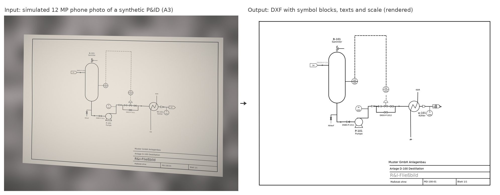
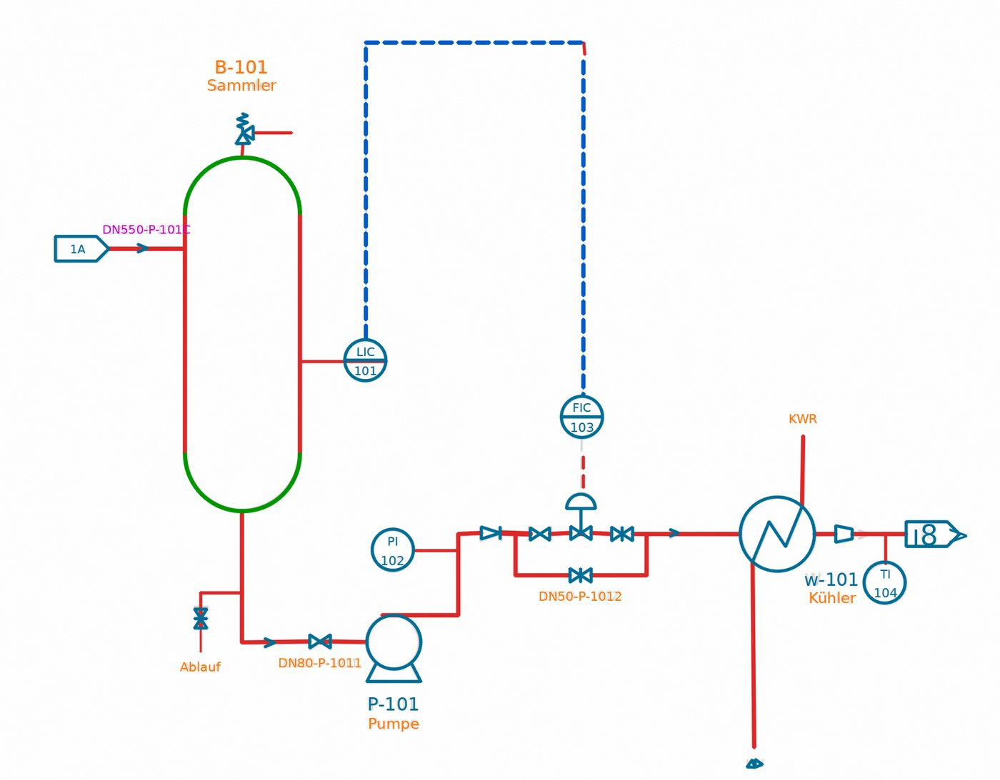

# Photos and scans to DXF (`vectorize`)

Engineering teams often receive plans only as phone photos or scans. The job operation `vectorize` (and the
`cad-ingest` command for photos and scans) turns them into an editable CAD drawing. The code is in `app/plan2cad`, the
job handler in `app/scan.py`.



*Synthetic test drawing from the benchmark, not a real document.*

## How it works

1. **Sheet**: finds the paper in the photo (GrabCut, edges refined at full resolution) and removes the perspective. If
   the paper runs out of the picture, it uses the printed drawing frame instead (aspect ratio from the perspective,
   Zhang & He). Scans without visible paper edges are deskewed.
2. **Light**: on a colour plot, takes the darkest colour channel as grey value where the colour is strong (so yellow
   and orange lines are ink as dark as black ones; colour casts of photos are too weak for this). On a black and white
   print, strong colour is a markup added by hand and is taken out of the drawing, see [Markups](#markups). Then it
   divides by the paper brightness (a closing that follows soft shadow edges) and binarises against the darkest ink
   nearby, so glare and light toner keep their lines. Fainter stretches of a stroke are added where they hang together
   with clear ink, so a pale or dotted line stays one line.
3. **Print size**: a large drawing is often printed small to take along, an A1 P&ID on A3 or A4. Its lettering is then
   much smaller than drawings are lettered (about 2.5 mm), and so are its symbols, pens and gaps. The most common
   height of the shapes of ink the size of a character tells the share it is printed at (half for A1 on A3); it is
   measured on the ink, not on what is read, as the text of a small print may be too small to read. Such a sheet is
   recognised at the drawing's drawn size, because the measures of recognition, such as how far a line may lie off a
   symbol's outline or how short a pipe may stop of a junction, are made for drawings at their drawn size: on a small
   print a plain line fitted a flow arrow, and pipes were not joined to their valves. Where the image has fewer than 5
   pixels per drawn millimetre, as a phone photo of a small print, lines and texts are found on the sheet as it is
   (at the drawn size they would fall apart into short pieces), and only objects and symbols are recognised and the
   linework connected at the drawn size. `report.json` gives the share as `printed` (1 for a drawing printed at its
   size), and the DXF is at the drawn size.
4. **Vectors**: filled areas (thicker than 1.5 mm), horizontal and vertical lines (morphology), circles (Hough, verified
   on all ink; text found on a ring is dropped as misread symbol arcs, and a ring whose quarters OCR took for brackets,
   such as a circle in a box, is found as well), everything else by skeleton tracing. A traced stroke that is round
   becomes one arc; one that runs straight and then bends is cut into the fewest straight lines and true arcs that
   follow it, so a rounded corner, a vessel head or the round end of a line-number box is one arc or a few tangent
   ones, not a chain of short lines. Arcs that lie on one circle and were cut apart by a line become one arc again.
   Collinear pieces are joined: a piece joins the line it continues at that line's own offset, so short strokes
   between two parallel lines, such as letters touching a pipe and the box of its line number, do not pull them onto
   one line. Regular pieces become dashed lines, corners are closed. Two or three dashes that run from
   one stroke to another, such as a short signal line between an instrument bubble and the symbol it acts on, become
   one dashed line; a short dash on its own is kept, not dropped as a speck. A gap of up to 5 mm in a line
   is closed where the grey image shows a stroke along it (a faint stretch darker than the paper beside it, a
   crossing that cut it), and a branch that stops short of the pipe it points at is extended onto it; gaps of bare
   paper, such as dashes and line jumps, and the inside of a small symbol stay open. The round ends of a line-number
   box and rounded corners between two lines are kept from text recognition, which would read them as brackets; only
   the part beyond the two line ends, so a letter touching a round end from inside the box is still read.
5. **Objects**: pieces that meet end to end become one polyline (a wall outline, a pipe run through its bends, a vessel
   with its heads); slivers and loose specks from the tracing are dropped. Floor plans get door swings (leaf and quarter
   arc) and walls, P&IDs equipment (large closed outlines), signal lines (dashed or ending at an instrument bubble) and
   pipes.
6. **Text**: characters of similar height are grouped into lines first, and small marks such as dots, hyphens and
   quotes join the line they sit in, so two text lines beside a slanted stroke stay apart. The lines are read by
   Tesseract in batches with its most accurate models (`tessdata_best`). A drawing is written in one font, so a
   character read unlike the glyphs that look most like it on the same sheet is corrected by their vote: the slashed
   zero of a plotter font reads as 8, 9 or B now and then, but as 0 mostly. In a code, an O or I next to a digit is a
   0 or 1 (`PN16`, `C=01XY2Z`). The sheet is turned if its text
   reads better turned: each rotation counts horizontal text the right way up together with vertical text reading
   bottom to top, so a P&ID full of vertical pipe labels is not taken for a sideways sheet. A single character is
   read where it stands alone in a frame, such as the loop letter of an instrument bubble or an interlock diamond;
   elsewhere a lone stroke of that size is as likely part of a symbol. The text in circles that hold text is read a
   second time without the ring and the line across a shared display, so letters that touch them are not lost. A box
   or ring around letters, such as the box of a line size, is no character: read with them, it garbled them. A bar
   read at either end of a line ("| LT"), the end of a leader beside the text, stays linework. The scale is read from
   the title block. The drawing type weighs room areas (m²) and a building scale against nominal sizes (DN),
   instrument bubbles and a title such as "R&I". Text that cannot be read reliably stays a text (a
   guess on its own layer to check) instead of turning into a heap of short strokes, also where the scan merged
   touching letters, as long as as many characters were read as the line's length holds (a valve read as two large
   letters stays linework).
   Then a learned text spotter reads the sheet once more: PP-OCRv6 small, a text detector and recogniser (Apache-2.0
   models run by RapidOCR on ONNX Runtime, on the CPU), finds the text lines in overlapping tiles of 1600 px (a sheet
   coarser than 10 px/mm is enlarged first, or small text is missed) and reads them. It finds letters that touch a
   line or the ring of a bubble, and reads plotter fonts, the slashed zero and touching letters much better than
   Tesseract. A spotted line replaces the texts whose letters lie in its box, unless it is a shorter reading across
   part of a text written the other way (a vertical dimension read as two numbers). Its letters are the components
   wholly in the box and about as high as most of them, so a pipe or a ring that touches the line, or a dash, stays
   linework.
   Where no text was found before, a reading needs a score of 0.8, and one of one or two characters 0.9 and no more
   than 1.6 times the usual text height: such a reading is as likely a symbol (a valve read as "D8", a fixture as
   "8"). A replacement scored below 0.8 is marked for review, and the characters both readers confuse go to the vote
   of their look-alikes on the sheet, Tesseract's readings among them, since the two readers make different
   mistakes. A line longer than the overlap of the tiles comes in pieces cut by a tile edge; the pieces of one line
   are read again as one. Where the characters map one to one to the glyphs, a space the recogniser dropped is put
   back at a gap 2.5 times as wide as the line's usual one ("11,56m²").
   Last, marks the readers confuse are put right where the sheet itself shows how it writes them. On a sheet with at
   least three pipe sizes in inches before their specification or in a reducer (`2" -AB12`, `4"x3"`), the mark after
   such a size, or after a nominal pipe size on its own, is an inch mark, whatever was read for it (`2°-AB12`, `2'`);
   angles (`45°`), temperatures (`60°C`) and feet and inches (`12'-6"`) keep theirs. On a sheet with at least two
   key=value labels (`PN=16`), a colon between a short key and its value (`PN:16`) is the equals sign.
7. **Symbols**: valves, pumps and instruments on P&IDs (and on drawings of unknown kind), toilets, washbasins, bathtubs
   and other fixtures on floor plans are looked up in symbol libraries and placed as their CAD blocks instead of loose
   strokes, see below.
   Then the linework is connected, so that it can be worked on in CAD without closing gaps by hand: tracing stops a
   line short of a junction by about the width of the line it meets, and taking out the strokes of a symbol leaves its
   pipes a little short of it. An end of a line or polyline that stops up to 2 mm short of other linework is moved
   along its line onto it (a branch onto its pipe, a signal line onto its bubble, a pipe onto its valve or vessel), or
   cut back onto a line it runs past by a little; two loose ends whose lines meet nearby form a corner there, and two
   that point at each other along one line meet halfway. A line drawn broken where it crosses another, to show that
   the two do not join, becomes one line across it, without a junction: two ends further than 2 mm from a single line
   between them, which point at each other along one line no more than 8 mm apart. A port of a symbol that no line reaches, but that faces a
   pipe or the port of the next symbol within 6 mm, is piped to it: the short pipe between a valve and its junction,
   with its flanges, is often lost with the strokes of the symbols around it. Pieces that then meet end to end become
   one polyline, through a crossing the ones that go straight on, and pieces under 2 mm that touch nothing are dropped
   as leftovers.
8. **Markups**: pen strokes and highlighter in colour on a black and white print become their own layers, see
   [Markups](#markups).

## Output

The ZIP holds `plan.dxf` (real-world millimetres, one layer per kind of object: `P2C-WALL`, `P2C-DOOR`, `P2C-PIPE`,
`P2C-EQUIPMENT`, `P2C-SIGNAL`, `P2C-FRAME`, `P2C-LINE`, `P2C-DASH`, `P2C-CURVE`, `P2C-FILL`, `P2C-TEXT`,
`P2C-TEXT-CHECK`, `P2C-SYMBOL`, `P2C-SYMBOL-CHECK`, and for markups `P2C-MARKUP`, `P2C-HIGHLIGHT` and
`P2C-MARKUP-TEXT`; ISO line weights, the
straightened photo `underlay.png` as raster underlay on `P2C-UNDERLAY`),
`plan.pdf` (vector, on the paper size), `overlay.png` (the recognised vectors in colour on the faded photo, symbols in
teal, for checking), `markup-k.png` for each markup and `report.json` (sheet, resolution, drawing type, scale, counts, timings, all texts, the symbols
with their attributes and ports, the lines joining two symbol ports, the markups and what to check). `extract` lists
the recognised texts, symbols (with their tags) and markups as markdown, so photographed plans become searchable too.

Every text of the DXF, the tags in a symbol's bubble included, is fitted between the ends of its baseline as printed
(DXF alignment "fit"), so that it is as long as on the paper in whatever font the CAD program shows it: a tag stays
inside its bubble, a line number inside its frame. The preview draws a text that would come out longer in its font
smaller. A text whose letters were found only in part (where they touch a line) keeps its natural length, as fitted
to that part it would shrink to a fraction of its size.

`report.json` lists what to check under `review`, least confident first: texts that could not be read
reliably (on `P2C-TEXT-CHECK`) and symbols that may be the wrong ones (on `P2C-SYMBOL-CHECK`, and in magenta in
`overlay.png` like the texts to check). A symbol is one to check where less than 90 % of its outline was found, or where
a symbol of another kind fits its place almost as well (with at least 90 % of its score); a ball valve and a gate
valve do not count as such, as the ball decides between them. Each entry says what was recognised, why it is
doubtful, where it is on the sheet and how confident the recognition is, so a person can look at just these places
instead of the whole sheet. A job can also have a vision model look at them first (`reviewer` in the [job
API](api.md)): it sees only a crop around each, and its answer is taken only where it fits the reading or the
library's symbol.

Scans often arrive as PDFs or TIFFs with several pages. Every page is converted on its own (one at a time, so memory
stays that of one page): the first page with a drawing at the root of the ZIP, every further page n in `page-n/` with
the same files. Pages without a drawing, such as a cover letter, are skipped with a warning. `options.pages` (command
line `--pages 1-3,5`) picks pages; a job converts at most `MAX_SCAN_PAGES` (20) and leaves out the pages it would not
finish within its time limit. Scanned PDF pages are rendered at 300 dpi; pages drawn in vectors are read directly,
see [Vector PDFs](#vector-pdfs).



*Detail of `overlay.png` for the synthetic P&ID above: solid lines in red, dashed lines in blue, arcs and circles in
green, library symbols in teal, texts in orange and texts to check in magenta. "DN550-P-101C" (really "DN50-P-1010")
was not read reliably, so it went to the review layer `P2C-TEXT-CHECK`.*

To try it on a single file without the job API (writes `plan.md`, `plan.pdf` and `plan.zip` to `out/`):

```bash
docker run --rm --user "$(id -u)" -v "$PWD:/data" -w /data ghcr.io/weyer-data-engineering/cad-ingest \
  cad-ingest plan.heic out --paper A3
```

There is no DWG output: the ODA File Converter may be used by non-members for non-commercial applications only, and
LibreDWG writes only old DWG versions, experimentally. AutoCAD and other CAD programs open the DXF directly.

## Markups

Plans come back from site and review with notes on them: a cloud around a valve with "removed" next to it, a pipe
struck out, a line marked with a highlighter. On a black and white print, every stroke in strong colour is such a
markup. Read as part of the drawing, it would turn into stray lines and symbols and garble the printed text under
it. So the converter takes markups out before it reads the drawing and keeps them on their own layers:

- **Pen strokes** become polylines in their colour on `P2C-MARKUP`. Strokes close to one another make one note.
- **Highlighter** (light colour at least 1 mm wide) becomes a transparent fill in its colour on `P2C-HIGHLIGHT`. The
  print under it shows through and is read as usual.
- **Handwriting** in a note is read by Tesseract where it can. The reading goes on `P2C-MARKUP-TEXT` as a guess to
  check: Tesseract is made for print, so it reads clear block letters and misses much of joined-up writing.
- **What a markup covers**: the printed texts and the tags of the symbols inside a pen loop, under a pen stroke or
  under highlighter, such as the instruments in a revision cloud.

`report.json` lists them under `markups`, each with its `kind` (`note` or `highlight`), `box_mm` (x0, y0, x1, y1 on
the sheet), `color` (RGB), the handwriting `reading` (or `null`), the printed `texts` and symbol tags it covers and its `image`: the
ZIP holds `markup-k.png` for each markup, the markup in colour on the faded print around it. These images are for a
person or a vision model to read what Tesseract could not. The markdown has a section `Markups (added by hand in
colour)`, for example `- Note in red: “removed” (handwriting, read automatically); covers: FV 101, FT 101`.

On a colour plot, where coloured lines are a large share of the ink, all colour is print and no markups are taken out.
Markups in black or grey cannot be told from the print.

## Vector PDFs

A PDF exported from CAD holds the drawing itself, not a picture of it. Such a page (at least 20 paths and no image
covering 30 % of it) is read as it is, without image recognition (`app/plan2cad/pdfvector.py`):

- Lines, arcs, circles, polylines and fills keep their exact geometry, colour and pen width (the DXF gets the nearest
  of all DXF line weights). CAD programs write arcs and circles as Bézier curves; curves that follow a circle within
  0.03 mm become arcs and circles again.
- Every element keeps the CAD layer it was drawn on where the PDF names it (optional content), and the DXF gets the
  same layers. The markdown lists the layers with the number of elements on each.
- Texts keep their string, angle and colour. Height, length and slant are measured on the text as it is drawn, and
  the DXF text is fitted between the ends of its baseline, so it covers the same place in any font.
- The page is the sheet: `paper` and `dpi` do not apply. `report.json` has `sheet` `page`, the page size, and `paper`
  `null` where that is no standard size. A page turned with /Rotate is read the way it is shown.
- Nothing is classified or replaced by symbols: walls, pipes and valves stay the strokes they were drawn as, on their
  layers, so the DXF shows exactly what the PDF shows. The drawing type and scale are still read from the texts.

A PDF page that is a scan, or a drawing flattened to an image, takes the image route described above.

## Symbol library

Recognised symbols become references (`INSERT`) to the blocks of a symbol library on the layer `P2C-SYMBOL`, with
their texts as attributes (the tag of a pump, the letters and number of an instrument), so the DXF holds a valve as a
valve, not as six strokes, and a washbasin as a washbasin. A symbol drawn around a circle, such as an instrument
bubble, is centred on the circle found in the scan, and a symbol a little beside the pipes that end at its ports, or
beside the pipe that runs through two of them (a flow arrow on its pipe), is moved across onto them. Pipe ends are
snapped onto the ports of the symbols they lead to where the port lies on the pipe's course (within 0.5 mm), so that no
pipe is turned askew; of parallel pipes ending beside one port, only the one pointing at it. Strokes left wholly inside
a symbol with ports, such as the one between the two triangles of a gate valve, are dropped: they would join the pipes
on either side through the valve. So are strokes left inside a symbol that holds text, such as an instrument bubble:
they are letters that could not be read, and the bubble is marked to check ("its text could not be read").

The symbols come from symbol libraries: DXF files with one block per symbol, with points where pipes connect and the
places of their attributes. Each library is for P&IDs or for floor plans, and only used on its kind of drawing. Two
starter libraries are built in, written by `bench/make_library.py`:

- `libraries/din-10628`: 18 simplified P&ID symbols after DIN EN ISO 10628-2: gate, ball, butterfly, check, angle,
  three-way, control and safety valve, centrifugal pump, compressor, heat exchanger, local and control-room instrument,
  reducer, filter, orifice plate, off-page connector and flow arrow.
- `libraries/floor-plan`: seven fixtures at real size: toilet, washbasin, bathtub, shower tray, kitchen sink with two
  bowls, hob and washing machine. They are shrunk by the scale of the drawing (from the title block or the job's
  `scale`; 1:50 and 1:100 are tried while it is unknown), and the DXF holds them at real size.

A company adds its own blocks as a library of its own, installed on the server or brought along by a job; [Symbol
libraries](symbol-libraries.md) explains the format and the tools that check and build one.

How a symbol is found: candidates come from two line ends that two ports of a symbol fit (a valve between two pipe
ends; this fixes position, turn and size), from rectangles whose proportions fit a rectangle of the symbol (the box of
a washbasin, whose back may be the face of the wall it hangs on), from circles (pumps, instruments, hotplates) and,
where nothing was found yet, from single pipe ends (straight lines from 4 mm; shorter strokes are mostly letters) and
from groups of small strokes. A symbol drawn on a pipe that goes on, such as a flow arrow, is tried where strokes
stand within 1.5 mm beside a straight line of at least 10 mm (a word traced as a line is shorter; not the frame or a
signal line), both ways along it: the pipe joins such strokes into one large group, so they are not found as a group
of their own. Each candidate is matched against the image itself (the centre lines of
the ink, not the traced vectors, which round off arrowheads and springs): a point of the symbol counts as found where
ink runs close by in the same direction. A symbol needs 85 % of its outline and half of each of its parts (a ball
valve needs its ball), a line leaving at least one port and, if it has one, a line through it that goes on for at
least a millimetre past both ends: where an arc runs into a line, the bend looks like an arrowhead, but no pipe goes
on past it. A symbol drawn the same as another one plus a small circle (a ball valve and a gate valve) is the one with
the circle where half of the circle's rim is there, or a blob as thick as the circle and one and a half times as thick
as the usual stroke of the sheet: a filled ball leaves that, and so does a ring that blur has filled in on a photo,
but not the crossing of two strokes. Ink inside the symbol that it does not explain counts against it, except for text
at its attribute positions and, in a symbol that holds text such as an instrument bubble, other text: letters in a
reducer are the cross of a box read as an "X". A stroke that ends freely in the library, such as a barb of a flow
arrow or a bar of an orifice plate, has to end on the sheet too: where the ink runs on past its end, the strokes belong
to something else, the pointed end of an off-page connector, the edge of a line number's frame or a letter. Of
overlapping candidates the one explaining the most ink wins. A symmetric symbol fits as
well turned half way or mirrored; it takes the pose in which most of its attribute positions have a text, and then the
one with its back on the wall: a fixture's insertion point is in the middle of its back, and the linework left around
it continues that side. Nothing is placed in the title block in the bottom right corner of the frame, whose small text
would otherwise look like symbols, nor in a strip of notes and tables below a line across the whole frame (revision
table, issue record, title block), whose grid looks like valves and arrows.

OCR often reads small fixtures at 1:100 as letters (a washbasin as "IOl"). So two opposite sides of a rectangle are
enough as a candidate, text may stand in for the outer outline and for small closed shapes such as a bowl or a
hotplate, and a text made of the strokes of a symbol is dropped once the symbol is found. The other way round, letters
must not make a symbol: on a dense P&ID, a V or an X in a pipe label fits a valve. A symbol may find at most 30 % of
its outline on text that reads as words or a code (anything but the circles and bars a symbol reads as, such as "oo"
or "101"). And the frame around a text (the box of a line number, an interlock diamond, the end of a label) is only
taken as a symbol that holds text inside its outline, such as an instrument bubble. A symbol drawn without curves
is not placed on a round stroke of its size: the round end of a line-number box is no off-page connector or arrow.
Nor is a symbol without a rectangle of its own placed with more than half of its linework on a small closed box (sides
2 to 15 mm): where the text in such a box was not read, its sides fit the ring of a bubble and its letters a valve.

Libraries whose symbols are drawn at the printed size (P&ID symbols, unlike fixtures) are drawn larger or smaller on
some sheets, for example a large drawing printed on a smaller sheet. The converter takes the size from the text: where
the sheet's median text height is more than a quarter larger or a fifth smaller than 2 mm, the symbols are looked
for at that ratio (between half and twice their size).

A sheet draws its symbols at one size. Once at least 12 symbols drawn at the printed size are found, their median size
is the sheet's, and candidates more than 1.4 times larger or smaller are left out: at the smallest size the library
allows, the x marks of a capillary line fit a flow arrow and a filled note marker fits an instrument bubble.
Fixtures are left alone, as their size is that of the real object.

## Benchmark

`bench/` generates drawings with an exact reference solution (floor plan A3, also with fixtures at 1:50 and 1:100;
P&ID A1/A0), simulates scans and phone photos (perspective, waviness, folds, shadow, glare, defocus, hand shake, noise,
phone sharpening, JPEG) and measures the result against the reference:

```bash
python bench/run.py --out bench/out [--quick] [--real photo.heic:A4]
```

Metrics: share of reference linework found within 1 mm / 0.5 mm on paper (completeness) and share of found linework
that is right (correctness), mean deviation, dashed lines, circles, exact texts, character error rate, scale, objects in
one piece, breaks per metre of line (where the output stops although the line runs on), curves in one piece and drawn
as arcs, symbols placed as the right block within 1.5 mm, attributes read, runtime. Mean over 1-3 seeds per case:

| Case | px/mm | Lines found / correct (<= 1 mm) | Mean deviation | Circles found | Texts exact | Symbols found / correct | Attributes read | Runtime |
|---|---|---|---|---|---|---|---|---|
| Floor plan A3, scan 300 dpi | 11.8 | 100 % / 100 % | 0.08 mm | - | 100 % | - | - | 7.8 s |
| Floor plan A3, phone photo 12 MP | 7.8 | 99.9 % / 100 % | 0.21 mm | - | 100 % | - | - | 5.3 s |
| Floor plan A3, phone photo 12 MP, hard | 6.7 | 77 % / 83 % | 0.44 mm | - | 30 % | - | - | 17.2 s |
| Floor plan A3 1:50 with fixtures, scan 300 dpi | 11.8 | 100 % / 100 % | 0.09 mm | 100 % | 100 % | 100 % / 100 % | - | 10.0 s |
| Floor plan A3 1:50 with fixtures, phone photo 12 MP | 7.8 | 99.9 % / 100 % | 0.22 mm | 78 % | 100 % | 100 % / 100 % | - | 6.6 s |
| Floor plan A3 1:100 with fixtures, scan 300 dpi | 11.8 | 99.9 % / 100 % | 0.10 mm | 100 % | 96 % | 96 % / 96 % | - | 9.7 s |
| Floor plan A3 1:100 with fixtures, phone photo 12 MP | 7.8 | 99.7 % / 99.9 % | 0.22 mm | 67 % | 90 % | 93 % / 90 % | - | 7.6 s |
| P&ID A1, scan 200 dpi | 7.9 | 99.9 % / 99.4 % | 0.12 mm | 100 % | 87 % | 94 % / 93 % | 87 % | 31.0 s |
| P&ID A1, phone photo 12 MP | 3.9 | 99.2 % / 96.7 % | 0.23 mm | 89 % | 18 % | 78 % / 77 % | 10 % | 32.4 s |
| P&ID A0, scan 200 dpi | 7.9 | 100 % / 98.9 % | 0.12 mm | 100 % | 84 % | 91 % / 91 % | 81 % | 53.3 s |
| P&ID A0, phone photo 12 MP | 2.8 | 90.6 % / 94.9 % | 0.33 mm | 82 % | 1 % | 62 % / 61 % | 0 % | 62.1 s |
| P&ID A0, phone photo 48 MP | 5.6 | 99.1 % / 98.3 % | 0.23 mm | 85 % | 34 % | 82 % / 85 % | 23 % | 45.4 s |

Linework and circles hold up down to 3 px per mm of paper, text does not: on the A0 P&ID, exact texts (2 mm high, many
of them inside instrument bubbles) rise from 14 % at 3 px/mm to 58 % at 6 and about 82 % from 8 px/mm. 81-99 % of the
objects of the reference drawing come out in one piece (1.13-1.88 DXF elements per object). Symbols that are missed
stay linework. On floor plans, all fixtures are found at 1:50; at 1:100, where OCR reads many of them as letters,
93-96 %.

## Limits

- Handwriting is read only in part (see [Markups](#markups)); the markup images in the ZIP show what it says.
- Small text needs about 8 px per mm of paper. An A0 sheet as one 12 MP photo has 2.8 px/mm, so its text is not
  readable; use 200-300 dpi scans for A0/A1. Unread text is kept as a guess on `P2C-TEXT-CHECK`.
- Thin lines (0.18 mm, e.g. dimension lines) need about 6 px per mm of paper. On a 12 MP photo of an A1 floor plan
  (4 px/mm) about two thirds of them are lost, and without a readable title block the scale stays unknown; pass
  `scale` and `drawing` in `options` when they are known.
- Measured line widths are too close to tell main pipes from thinner lines, so P&ID lines are classified by geometry,
  not by pen width.
- Non-flat paper (waves, folds) shifts lines by up to a millimetre; there is no dewarping yet.
- Only symbols in the selected libraries are recognised; anything else stays linework. Fine details need resolution:
  below about 6 px per mm of paper a ball valve's ball is lost and it comes out as a gate valve. The orifice plate of
  the starter library (two short bars across a pipe) is not found yet.
- Fixtures at 1:100 (a washbasin is 6 x 4.5 mm on the sheet) are mostly read as letters; about one in ten is placed
  as the wrong fixture or the wrong way round, for example a fixture in a corner, which fits both walls.
- Fixtures are only found at the drawing scale; while it is unknown, 1:50 and 1:100 are tried. Pass `scale` in
  `options` for other scales.
- Symbol recognition adds about 20 s to an A1 sheet and 35 s to an A0 sheet with the starter library; larger
  libraries take longer.
- Vector PDFs: symbols are not recognised on them yet, and a text is a single-line TEXT in the DXF's standard font,
  stretched to the length it has in the PDF. White fills count as paper and are left out, so a white mask over lines
  (such as a text background) does not hide them in the DXF.
